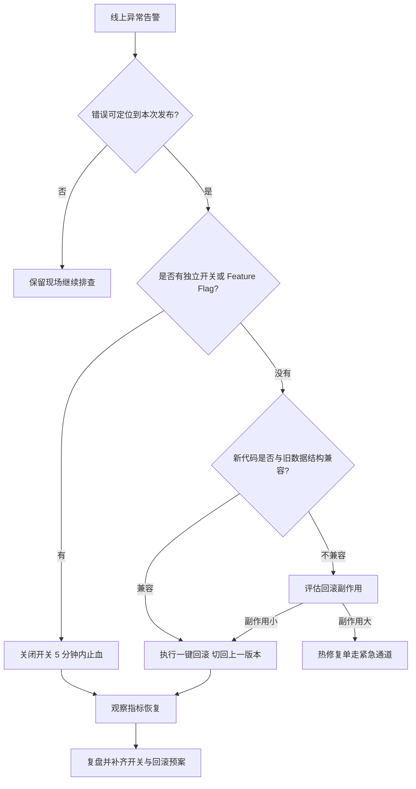

## OPS-010：如何保证发布操作幂等？并发发布冲突怎么防？
**答**：
- 幂等：同一发布任务重复执行结果一致——版本化目录 + symlink 切换天然幂等，rsync 重复执行无副作用。
- 并发锁：两个人同时发布会互相覆盖 current，必须加互斥锁；单机用 flock，分布式用 Redis SETNX 或数据库唯一行。
- 锁要有租约（自动超时释放），防止发布中途 CI 崩溃导致死锁。
- 发布平台还要校验"当前基线"：提交发布时记录 base 版本，若线上已被人推进，拒绝过期任务。

```bash
#!/usr/bin/env bash
# publish_locked.sh：flock 保证同一时间只有一个发布任务在跑，且可重复执行
set -euo pipefail

LOCK_FILE="/var/lock/webapp-publish.lock"
VERSION="${1:?usage: publish_locked.sh <version>}"

# -w 300：最多等 300 秒拿锁；拿到锁后执行发布，退出自动释放
exec 200>"$LOCK_FILE"
if ! flock -w 300 200; then
  echo "ERROR: another publish is running, abort" >&2
  exit 1
fi

publish() {
  local target="/data/web/mall/releases/$VERSION"

  # 幂等点 1：目标目录已存在且校验通过则直接切换（重复执行安全）
  if [ -d "$target" ] && [ -f "$target/.ok" ]; then
    echo "$target already deployed, just switching symlink"
  else
    rsync -azc --delete "/tmp/build/dist/" "deploy@web01:$target/"
    ssh deploy@web01 "touch $target/.ok"   # 完整性标记
  fi

  # 幂等点 2：切换 symlink，无论执行多少次，最终状态一致
  ssh deploy@web01 "ln -sfn $target /data/web/mall/current"
  echo "published $VERSION at $(date -Is)"
}

publish
```

---

## 二、回滚与兜底（OPS-011 ~ OPS-018）

回滚与兜底回答"上线出事怎么办"。原则是：止血永远优先于定位，能一键回滚就不人工修，能用开关降级就不整体回滚。所有方案都要在没事的时候演练过，真出事才敢用。


