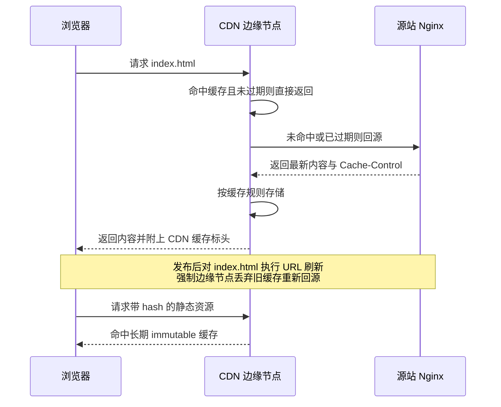

## OPS-018：发布后的冒烟测试如何自动化？
**答**：
- 冒烟范围：首页可渲染、核心接口 200、关键交互路径（登录→列表→详情→下单）可通过、无 JS 致命错误。
- 层级选择：优先 curl 层做 30 秒内的快速检查（状态码+关键文本），再用 Playwright/Puppeteer 做渲染级验证（root 有内容、无 console error）。
- 冒烟失败要联动：非阻塞提示 → 阻断放量 → 自动回滚（按严重程度配置），且结果写回变更单。
- 多环境复用同一套脚本，预发跑全量用例、生产跑精简关键链路。

```javascript
// smoke.js：发布后冒烟（node >= 18，无额外依赖），生产用精简版
const BASE = process.env.SMOKE_BASE || 'https://www.example.com';
const checks = [
  { name: 'index 200',           fn: () => get(`${BASE}/`, /<div id="app"/) },
  { name: 'healthz ok',          fn: () => get(`${BASE}/healthz`, /ok/) },
  { name: 'api config 200',      fn: () => get(`${BASE}/api/config`, /"version"/) },
  { name: 'static asset hashed', fn: () => get(`${BASE}/assets/`, null, 200) },
];

async function get(url, pattern, expect = 200) {
  const res = await fetch(url, { redirect: 'follow' });
  if (res.status !== expect) throw new Error(`${url} -> ${res.status}`);
  if (pattern) {
    const text = await res.text();
    if (!pattern.test(text)) throw new Error(`${url} body mismatch`);
  }
}

let failed = 0;
for (const c of checks) {
  try { await c.fn(); console.log(`PASS ${c.name}`); }
  catch (e) { failed++; console.error(`FAIL ${c.name}: ${e.message}`); }
}

if (failed > 0) {
  // 冒烟失败回调发布平台：暂停放量/触发回滚
  await fetch(process.env.RELEASE_WEBHOOK, {
    method: 'POST',
    headers: { 'Content-Type': 'application/json' },
    body: JSON.stringify({ release: process.env.RELEASE_VERSION, smoke: 'failed', failed }),
  }).catch(() => {});
  process.exit(1);
}
console.log('ALL SMOKE PASSED');
```

---

## 三、CDN 与域名（OPS-019 ~ OPS-028）

CDN 是前端流量进入的第一跳，也是缓存问题、劫持问题、证书问题的多发区。这一章的关键是理解"源站→边缘→浏览器"的缓存链路，以及每个环节怎么刷、怎么验、怎么兜底。


