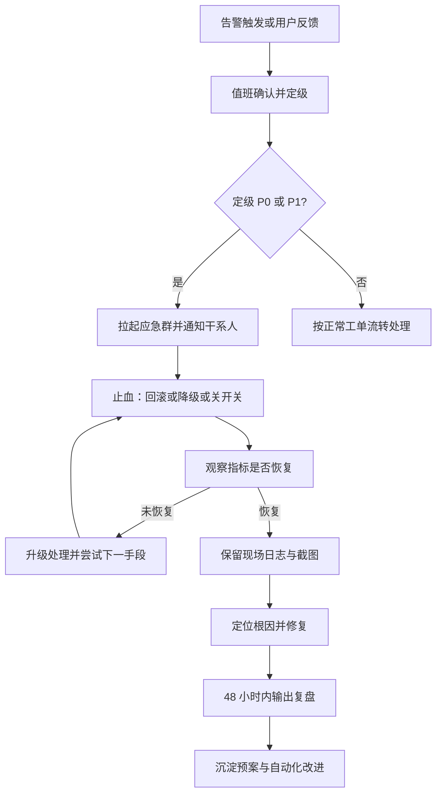

## OPS-082：sourcemap 泄露有哪些风险？如何系统性防住？
**答**：
- 风险：map 暴露完整源码（业务逻辑、内部接口结构、注释里的敏感信息），也大幅降低攻击者利用 XSS 的成本（精准定位注入点）。
- 四道防线：构建产物剔除 map（部署前 find -delete）、Nginx/CDN 拒绝 .map 请求（双保险防漏删）、map 只走监控平台专用通道、CI 卡点检查产物无 map。
- 泄露检测：定期对线上资源探测 .map 是否 404；接入证书透明度/资产扫描发现"意外的公开 map"。
- 团队规范：任何人不得把 map 传到公共 CDN/对象存储公开桶，制品库权限收敛。

```nginx
# 防线 1 + 2：产物剔除之外的兜底——服务端直接拒绝 .map 请求
server {
    listen 443 ssl http2;
    server_name www.example.com;

    # 任何路径下的 .map / .ts / 源码文件一律 403，并记录命中日志
    # （正常流量不该出现这些请求，出现即说明产物剔除有遗漏，日志要监控）
    location ~* \.(map|ts|tsx|vue|jsx|less|scss)$ {
        access_log /var/log/nginx/map_leak_attempt.log;
        return 403;
    }

    # CDN 层同理：对 *.map 配置"不缓存 + 返回 403"规则，
    # 即使旧版本 map 曾被缓存也能通过刷新+403 快速止血

    location / {
        root /data/web/current;
        try_files $uri $uri/ /index.html;
    }
}

# 防线 3：CI 里的产物检查卡点（bash 示意）
# find dist -name '*.map' | grep -q . && {
#   echo "ERROR: dist 中存在 sourcemap，禁止发布"; exit 1;
# }
```

---

## 十、事故应急与大促保障（OPS-083 ~ OPS-100）

应急响应的黄金法则：先止损、再定位、后复盘。大促保障的本质是把"可能出的事"提前推演并准备好开关。本章是前面九章能力的综合应用。


