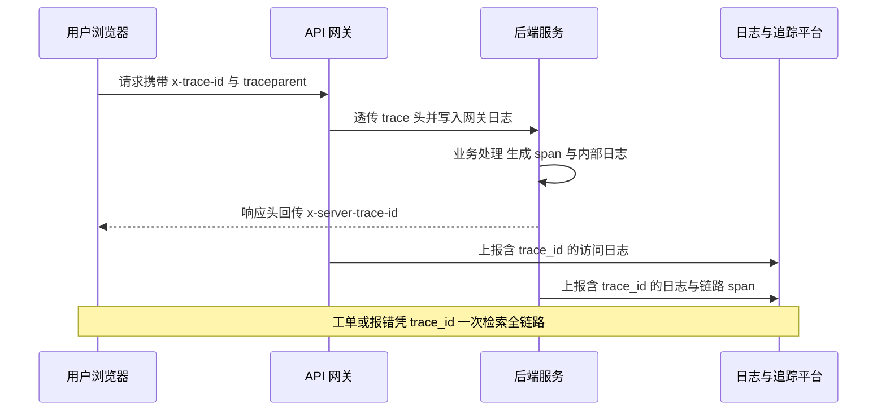

## OPS-129：traceId 全链路透传怎么设计？从前端 header 注入到后端日志到工单如何串起来？
**答**：
- 前端统一请求层为每个请求注入 x-trace-id（可从网关/上游继承，保持同一用户行为同一 trace）。
- 网关与后端提取该头写入访问日志与应用日志，追踪系统以它为根串联全部 span；响应头回传服务端内部 trace 便于二次检索。
- 错误上报、客服工单、用户反馈都携带同一 traceId：值班拿到工单一跳到链路视图，定位从"查一圈"变成"点一下"。
- 全链路检索依赖日志字段规范：trace_id 是保留字段，所有服务不允许改名。
- 透传协议兼容主流生态（W3C traceparent、B3），避免自造格式无法与后端 APM 对接。

```javascript
// traceId 透传三段式：前端生成注入 → 后端日志承接 → 响应回传服务端 trace
function getTraceId() {
  return (window.__traceId__ ||= crypto.randomUUID().replaceAll('-', ''));
}

async function request(url, options = {}) {
  const traceId = getTraceId();
  const resp = await fetch(url, {
    ...options,
    headers: {
      ...options.headers,
      'x-trace-id': traceId,        // 1. 网关/后端提取并写入访问日志与应用日志
      'x-b3-traceid': traceId,      // 兼容 Zipkin/B3 生态
      traceparent: `00-${traceId}-${crypto.randomUUID().replaceAll('-', '')}-01`, // W3C 标准
    },
  });

  // 2. 响应回传后端内部 trace，前端报错时两者都带上
  const serverTrace = resp.headers.get('x-server-trace-id');
  window.__lastTraces__ = { traceId, serverTrace };

  if (!resp.ok) reportError(url, resp.status, { traceId, serverTrace });  // 3. 错误上报同 trace
  return resp;
}

// 4. 客服工单/用户反馈绑定 traceId：工单 → 日志 → 链路视图一次跳转（OPS-179）
```


