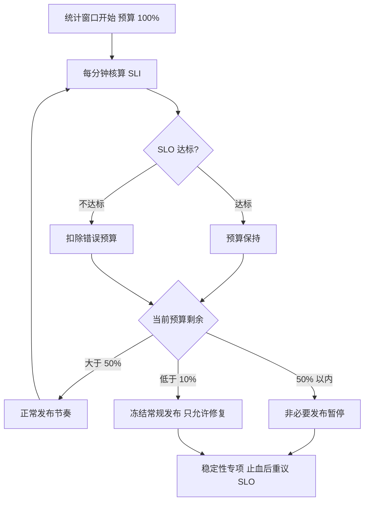

## OPS-133：SLI/SLO/错误预算怎么定？错误预算如何驱动发布决策？
**答**：
- SLI 必须可测量可归因："用户觉得慢"不是 SLI，"LCP p75 < 2.5s 的会话占比"才是；前端常见 SLI：首屏可用性、接口成功率、无错误会话占比。
- SLO 按 28 天窗口设目标（99.9% 对应约 1 小时错误预算），预算 = 100% - SLO。
- 错误预算是发布节流的开关：消耗过半收紧非必要发布，接近耗尽冻结只允许修复，恢复后重议 SLO 是否定得合理。
- SLO 要挂"前端视角"的指标（RUM/拨测），不能只用服务端 5xx——服务端全绿但前端资源 404 照样事故。
- 预算消耗看板对全团队透明，与发布平台联动自动拦截（不靠自觉）。

```yaml
# web-frontend 服务的 SLO 与错误预算策略
service: web-frontend
sli:
  - name: 首屏可用性
    definition: index.html 返回 200 且 LCP < 4s 的会话占比
    source: RUM + 多地拨测
  - name: 接口成功率
    definition: 前端视角 2xx 占比（4xx 单独归因到客户端问题）
  - name: 无错误会话占比
    definition: 无未捕获 JS 错误的会话占比
slo:
  - sli: 首屏可用性
    target: 99.9%            # 28 天窗口 → 预算约 60 分钟
  - sli: 接口成功率
    target: 99.95%
error_budget_policy:
  - consumed_below_50pct: 正常发布节奏
  - consumed_50_90pct: 非必要发布暂停，优先稳定性项
  - consumed_above_90pct: 冻结常规发布，只允许修复类发布
  - consumed_100pct: 事故复盘 + 重议 SLO 合理性
notes:
  - SLO 挂前端视角指标（RUM/拨测），服务端全绿不等于用户没受影响
  - 预算拦截由发布平台自动执行（与 OPS-133 流程图联动），不依赖人自觉
```


