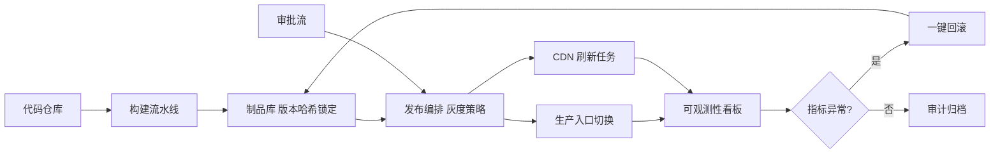

## OPS-137：设计一个前端发布平台，功能模型包含哪些模块？核心原则是什么？
**答**：
- 五大模块：构建（流水线触发与产物扫描）、制品（版本管理与哈希锁定）、发布（环境晋升与灰度）、回滚（一键任意版本）、审计（谁在何时发了什么）。
- 核心原则一：产物不可变——同版本号禁止覆盖，发布即选择制品而非重新构建。
- 核心原则二：发布即切流——入口文件是唯一开关，回滚就是反向切流（OPS-140），秒级且不重新构建。
- 核心原则三：所有人工动作都有 API 化替代，审批/刷新/通知全部留痕，为自动化与审计铺路。
- 配置与产物分离：版本内不携带环境配置，运行时由配置中心下发（OPS-059 章的延续）。

```json
{
  "release_platform": {
    "modules": {
      "build": ["触发方式：手动 / tag / 合并自动", "流水线：安装-测试-打包-体积与安全扫描", "产物上传制品库并锁定哈希"],
      "artifact": ["版本号与 git sha 双标识", "不可变约束：同版本号禁止覆盖", "产物详情：体积报告 / sourcemap 索引 / 依赖清单"],
      "release": ["环境晋升 dev → staging → prod", "灰度策略：百分比 / 白名单 / 机房", "执行通道：入口文件切换 + CDN 刷新任务化"],
      "rollback": ["一键回滚到任意历史制品", "回滚同样留审计记录（事后补审）", "回滚演练每月计时验证（见 OPS-137 备注）"],
      "audit": ["谁在何时发了什么到哪个环境", "审批记录与变更单/发布单关联", "全部操作 API 化并留痕"]
    },
    "principles": [
      "产物与配置分离：版本不可变，配置运行时下发",
      "发布即切流：入口文件是唯一开关，回滚是反向切流",
      "人工动作全部有 API 替代，先留痕再自动化"
    ]
  }
}
```


