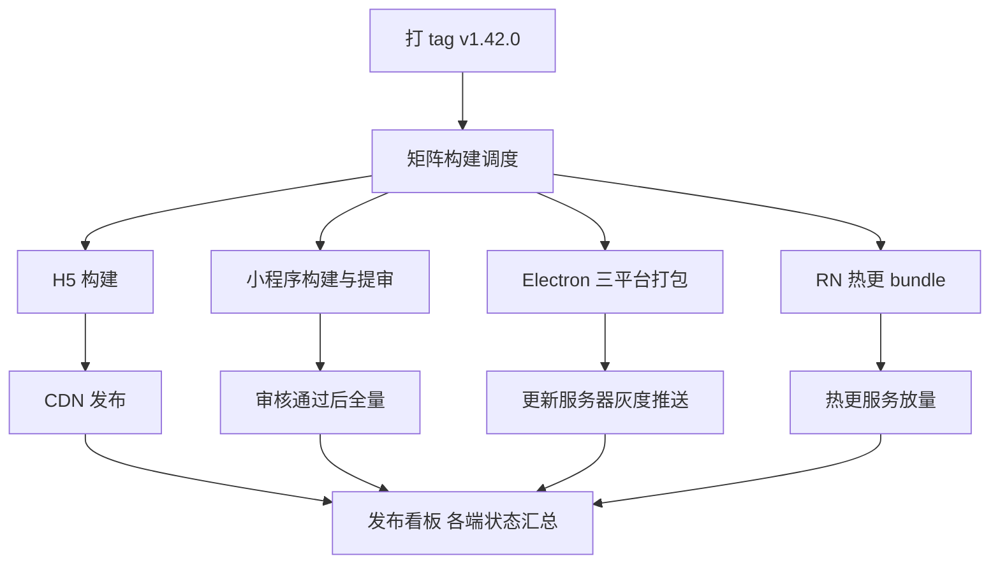

## OPS-167：一码多发的矩阵构建怎么编排？
**答**：
- 触发一次（tag v1.42.0）→ 矩阵并行构建多端产物：H5、小程序、Electron 三平台、RN 热更 bundle。
- 共享步骤前置：版本号统一写入各端配置、公共配置生成、产物清单汇总——避免各端版本漂移。
- 失败隔离：单端失败不阻塞其他端，但 release train 整体标记 partial，责任人认领。
- 产物统一登记制品库，发布看板展示各端状态（构建/提审/灰度/全量），一屏看清一码多发的进度。
- 各端发布动作不同（CDN 切换/提审/更新服务器推送），但都收敛到发布平台的统一动作 API（OPS-137）。

```yaml
# 一码多发矩阵构建：一次 tag 触发多端构建
release_matrix:
  version_source: package.json@1.42.0     # 唯一版本源（OPS-160）
  jobs:
    h5:
      cmd: pnpm build:h5
      artifact: dist/h5 → CDN 发布 + 入口切换
    mp-weixin:
      cmd: pnpm build:mp && node scripts/upload-mp.js
      artifact: 小程序包 → 微信后台提审（OPS-162）
      depends: h5                          # 共享构建配置先生成
    electron:
      cmd: pnpm build:electron --publish always
      artifact: 安装包 → 更新服务器 stable 通道（OPS-163）
      matrix_os: [mac, win, linux]
    rn:
      cmd: pnpm bundle:ios && pnpm bundle:android
      artifact: 热更 bundle → pushy 服务（OPS-164）
orchestration:
  - 触发：tag v1.42.0 → 全矩阵并行构建
  - 共享步骤前置：版本号写入各端配置、产物清单统一生成
  - 失败隔离：单端失败不阻塞其他端，release train 标记 partial 并认领
  - 产物统一登记制品库，发布看板汇总各端状态
```



---

## 十九、容灾与演练（OPS-168 ~ OPS-175）

容灾方案的另一半是"演练过没演练过"：多活概念、逐级 fallback、演练脚本、混沌注入、预案、RTO/RPO、降级矩阵与故障注入 SDK。
