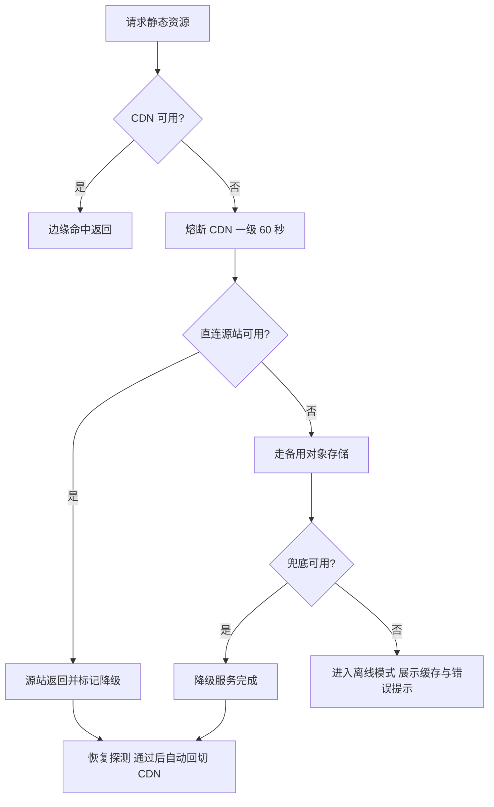

## OPS-169：静态资源多源容灾的逐级 fallback 怎么实现？
**答**：
- 三级资源池：CDN（主）→ 直连源站（CDN 故障时）→ 备用对象存储（双写第三副本，兜底）——三级必须跨供应商，避免共用故障域。
- 前端加载器按顺序尝试，失败即熔断该级 60 秒，窗口内直接走下一级，避免反复撞墙放大延迟。
- 失败状态记录 + 恢复探测：降级期间定期探活上级，恢复后自动回切。
- 入口 html 由网关下发多源提示（preconnect/meta），减少逐级试错的连接建立开销。
- 关键指标：降级事件的次数与时长进可用性报表，频繁降级说明主链路有问题而不是兜底厉害。

```javascript
// 静态资源逐级兜底：CDN → 源站 → 备用对象存储
const LEVELS = [
  'https://cdn.example.com',            // 一级：CDN
  'https://static-origin.example.com',  // 二级：直连源站（CDN 故障时）
  'https://backup-oss.example.com',     // 三级：备用对象存储（双写第三副本）
];
// 三级跨供应商，避免共用故障域
const failedUntil = {};   // 失败熔断表：key = base+path

function pickBase(path) {
  const now = Date.now();
  return LEVELS.find((base) => (failedUntil[`${base}${path}`] ?? 0) < now) ?? LEVELS[2];
}

export function loadScript(path) {
  return new Promise((resolve, reject) => {
    const tryLoad = (i = 0) => {
      const s = document.createElement('script');
      s.src = pickBase(path) + path;
      s.onload = () => resolve({ src: s.src });
      s.onerror = () => {
        failedUntil[s.src] = Date.now() + 60_000;   // 该级熔断 60s，窗口内直接走下一级
        s.remove();
        if (i + 1 < LEVELS.length) tryLoad(i + 1);
        else reject(new Error('all static sources failed'));
      };
      document.head.appendChild(s);
    };
    tryLoad();
  });
}
// 恢复探测：降级期间每 30s 探活上级，恢复后自动回切
// 指标：降级事件次数与时长上报，进可用性报表（OPS-136）
```


