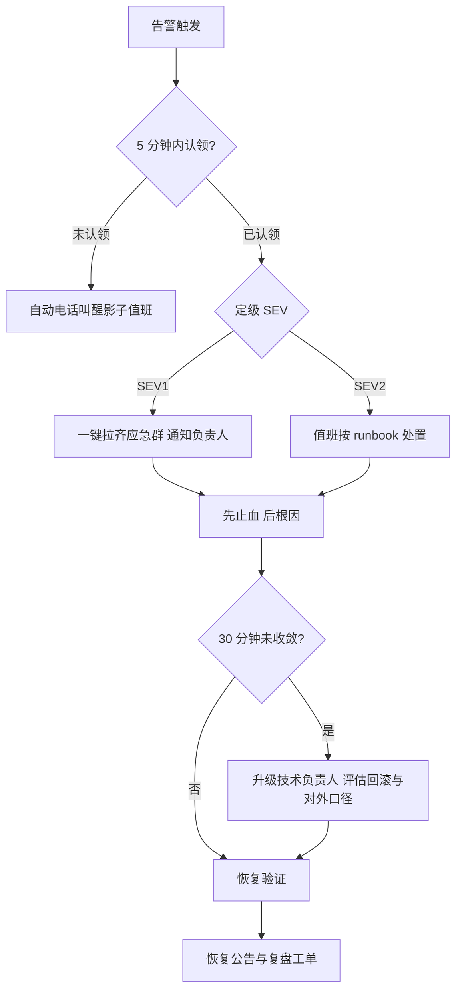

## OPS-177：值班 SOP 的响应时限与升级路径怎么定？
**答**：
- 三个时限：5 分钟内认领告警（超时自动升级）、15 分钟内给出初步判断（止血/观察/误报）、SEV1 10 分钟未定位即升级负责人。
- 升级路径三级：值班（runbook 处置）→ 前后端负责人 → 技术总监（跨域协调与对外口径），每级有明确触发条件。
- 铁律"先止血后根因"：先回滚/降级/切流，再查原因；止血手段来自降级矩阵与预案（OPS-174/172）。
- 事故沟通节奏固定：每 15 分钟在事故群同步进展；对外公告由 PR 统一发（OPS-193）。
- SOP 工具化：认领超时自动升级、应急群一键拉齐（OPS-196/199），流程不依赖人记得住。

```yaml
# 值班 SOP：响应时限与升级路径
response_sla:
  ack: 5 分钟               # 告警认领，超时自动电话叫醒 secondary（OPS-199）
  initial_action: 15 分钟内给出初步判断（止血 / 观察 / 误报）
  sev1_escalate: 10 分钟未定位即升级技术负责人，同步 PR 备对外口径
escalation_path:
  - l1: 前端值班（按 runbook 处置，OPS-183）
  - l2: 前端负责人 + 关联后端值班（10 分钟未定位触发）
  - l3: 技术总监（30 分钟未收敛或跨域协调）
channels:
  alert_in: 值班 IM 机器人（聚合降噪后推送，OPS-178）
  incident_room: 事故群模板一键拉齐（值班 / 负责人 / 后端 / QA / PR，OPS-196）
  comms: 每 15 分钟同步进展；对外公告由 PR 统一（OPS-193）
rules:
  - 先止血后根因：回滚 / 降级 / 切流优先（OPS-174 矩阵）
  - 值班期间非紧急变更一律推迟（OPS-176）
```


