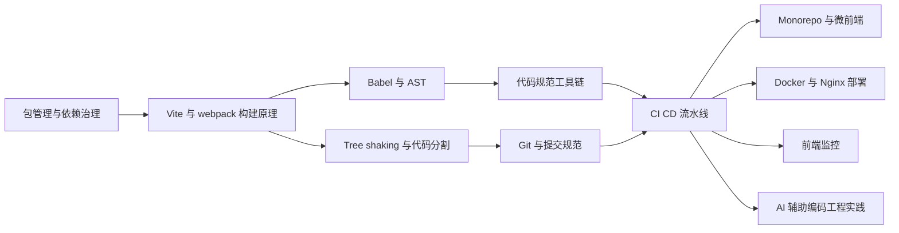

# 前端工程化面试题库

> 面向前端面试场景的工程化题库，共 200 题（ENG-001 ~ ENG-200）。覆盖包管理与 lockfile、语义化版本、Vite 原理、webpack 核心、Rollup/esbuild/SWC、Babel 与 AST、Tree-shaking、代码分割、source map、ESLint/Prettier/husky/commitlint、Git 工作流、CI/CD、Monorepo、微前端、Vitest 单测、包发布、环境变量、Docker 与 Nginx 部署、前端监控、AI 辅助编码的工程化实践，以及包管理深水区、脚手架、规范深化、Git 深水区、配置管理、CI/CD 深化、测试工程化、Monorepo 深化、质量度量、AI 工程化、构建集成、发布工程、文档知识、依赖治理、微前端工程化、移动多端、研发协作、安全工程化与体系前瞻等深化专题。

## 目录

- 第一章 包管理与依赖治理：ENG-001 ~ ENG-008
- 第二章 Vite 原理与实践：ENG-009 ~ ENG-014
- 第三章 webpack 核心：ENG-015 ~ ENG-021
- 第四章 Rollup esbuild 与 SWC：ENG-022 ~ ENG-024
- 第五章 Babel AST 与 Tree shaking：ENG-025 ~ ENG-030
- 第六章 代码规范工具链：ENG-031 ~ ENG-034
- 第七章 Git 工作流：ENG-035 ~ ENG-039
- 第八章 CI CD：ENG-040 ~ ENG-043
- 第九章 Monorepo：ENG-044 ~ ENG-046
- 第十章 微前端：ENG-047 ~ ENG-048
- 第十一章 单元测试 Vitest：ENG-049 ~ ENG-050
- 第十二章 发布与环境变量：ENG-051 ~ ENG-053
- 第十三章 Docker 与 Nginx 部署：ENG-054 ~ ENG-056
- 第十四章 前端监控：ENG-057 ~ ENG-058
- 第十五章 AI 辅助编码工程实践：ENG-059 ~ ENG-060
- 第十六章 包管理深水区：ENG-061 ~ ENG-066
- 第十七章 脚手架与模板：ENG-067 ~ ENG-072
- 第十八章 代码规范深化：ENG-073 ~ ENG-079
- 第十九章 Git 深水区：ENG-080 ~ ENG-086
- 第二十章 环境与配置管理：ENG-087 ~ ENG-092
- 第二十一章 CI CD 深化：ENG-093 ~ ENG-099
- 第二十二章 测试工程化：ENG-100 ~ ENG-105
- 第二十三章 Monorepo 深化：ENG-106 ~ ENG-111
- 第二十四章 质量与度量：ENG-112 ~ ENG-117
- 第二十五章 AI 工程化与新范式：ENG-118 ~ ENG-130
- 第二十六章 构建集成与优化工程：ENG-131 ~ ENG-136
- 第二十七章 发布工程深化：ENG-137 ~ ENG-142
- 第二十八章 文档与知识工程：ENG-143 ~ ENG-147
- 第二十九章 依赖治理：ENG-148 ~ ENG-153
- 第三十章 微前端工程化：ENG-154 ~ ENG-158
- 第三十一章 移动与多端工程：ENG-159 ~ ENG-163
- 第三十二章 研发流程与协作：ENG-164 ~ ENG-169
- 第三十三章 安全工程化：ENG-170 ~ ENG-174
- 第三十四章 AI 深度工程化：ENG-175 ~ ENG-182
- 第三十五章 体系与前瞻：ENG-183 ~ ENG-200

---

## 第一章 包管理与依赖治理（ENG-001 ~ ENG-008）

