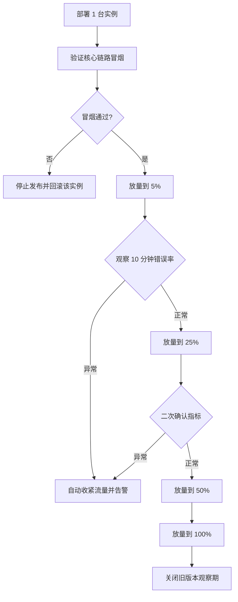

# 前端面试题库：前端运维与上线

> 面向前端面试场景的运维与上线题库，共 200 题（OPS-001 ~ OPS-200，其中 001 ~ 100 为首发，101 ~ 200 后续补充）。覆盖发布策略、回滚与兜底、CDN 与域名、Nginx 实战、容器与编排、CI/CD 流水线、环境与配置、监控告警、sourcemap 错误定位、事故应急与大促保障。核心考察点：工程师能不能把代码安全稳定地送上生产，出事时能不能快速止血兜底。与 08-engineering.md（ENG，构建工具链/规范/基础 CI）互补，本文聚焦"上线之后"的运维生命周期。

## 目录

- 一、发布策略：OPS-001 ~ OPS-010
- 二、回滚与兜底：OPS-011 ~ OPS-018
- 三、CDN 与域名：OPS-019 ~ OPS-028
- 四、Nginx 实战：OPS-029 ~ OPS-040
- 五、容器与编排：OPS-041 ~ OPS-048
- 六、CI/CD 流水线：OPS-049 ~ OPS-058
- 七、环境与配置：OPS-059 ~ OPS-066
- 八、监控告警：OPS-067 ~ OPS-076
- 九、sourcemap 与错误定位：OPS-077 ~ OPS-082
- 十、事故应急与大促保障：OPS-083 ~ OPS-100
- 十一、Nginx 高阶：OPS-101 ~ OPS-110
- 十二、CDN 深入与边缘：OPS-111 ~ OPS-118
- 十三、K8s 深入：OPS-119 ~ OPS-126
- 十四、可观测性深入：OPS-127 ~ OPS-136
- 十五、发布系统设计：OPS-137 ~ OPS-143
- 十六、安全运维：OPS-144 ~ OPS-152
- 十七、成本与效率：OPS-153 ~ OPS-159
- 十八、多端发布：OPS-160 ~ OPS-167
- 十九、容灾与演练：OPS-168 ~ OPS-175
- 二十、值班与流程：OPS-176 ~ OPS-200

---

## 一、发布策略（OPS-001 ~ OPS-010）

发布策略回答的问题是"新版本以什么节奏、什么范围、什么可逆方式进入生产"。核心矛盾是稳定性与发布速度的权衡：全量发布快但爆炸半径大，灰度/金丝雀可控但需要观测数据支撑决策。

