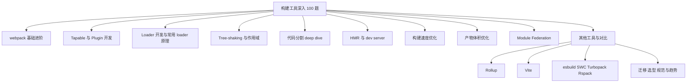

# 前端面试题库：构建工具深入（webpack / Vite / Rollup / esbuild）

> 面向大厂前端面试的构建工具专题题库，共 200 题（BLD-001 ~ BLD-200，全部收录）。定位"构建工具深入"：webpack 原理与 Plugin/Loader 开发、Tree-shaking、代码分割 deep dive、HMR 全链路、构建速度与产物体积优化实操、Module Federation，以及 Vite / Rollup / esbuild / SWC 等新一代工具链，聚焦字节、阿里等大厂高频考察点。与 ENG（基础工具链）、OPT（产物优化业务侧）题库互补，不重复。

## 目录

- 第一章 webpack 基础进阶：BLD-001 ~ BLD-008
- 第二章 Tapable 与 Plugin 开发：BLD-009 ~ BLD-016
- 第三章 Loader 开发与常用 loader 原理：BLD-017 ~ BLD-024
- 第四章 Tree-shaking 与作用域：BLD-025 ~ BLD-030
- 第五章 代码分割 deep dive：BLD-031 ~ BLD-038
- 第六章 HMR 与 dev server：BLD-039 ~ BLD-045
- 第七章 性能优化之构建速度：BLD-046 ~ BLD-052
- 第八章 性能优化之产物体积：BLD-053 ~ BLD-060
- 第九章 Module Federation：BLD-061 ~ BLD-068
- 第十章 其他工具与对比：BLD-069 ~ BLD-100
- 十一章 webpack 源码级深入：BLD-101 ~ BLD-110
- 十二章 webpack 高级场景：BLD-111 ~ BLD-118
- 十三章 Babel 与 AST 深入：BLD-119 ~ BLD-128
- 十四章 Vite 源码级与实践深水区：BLD-129 ~ BLD-140
- 十五章 Rollup 深入与库构建：BLD-141 ~ BLD-148
- 十六章 esbuild / SWC 与新工具实践：BLD-149 ~ BLD-156
- 十七章 缓存与增量构建体系：BLD-157 ~ BLD-163
- 十八章 构建产物与运行时：BLD-164 ~ BLD-170
- 十九章 工程化与协作：BLD-171 ~ BLD-178
- 二十章 综合实战：BLD-179 ~ BLD-200

---

## 第一章 webpack 基础进阶（BLD-001 ~ BLD-008）

