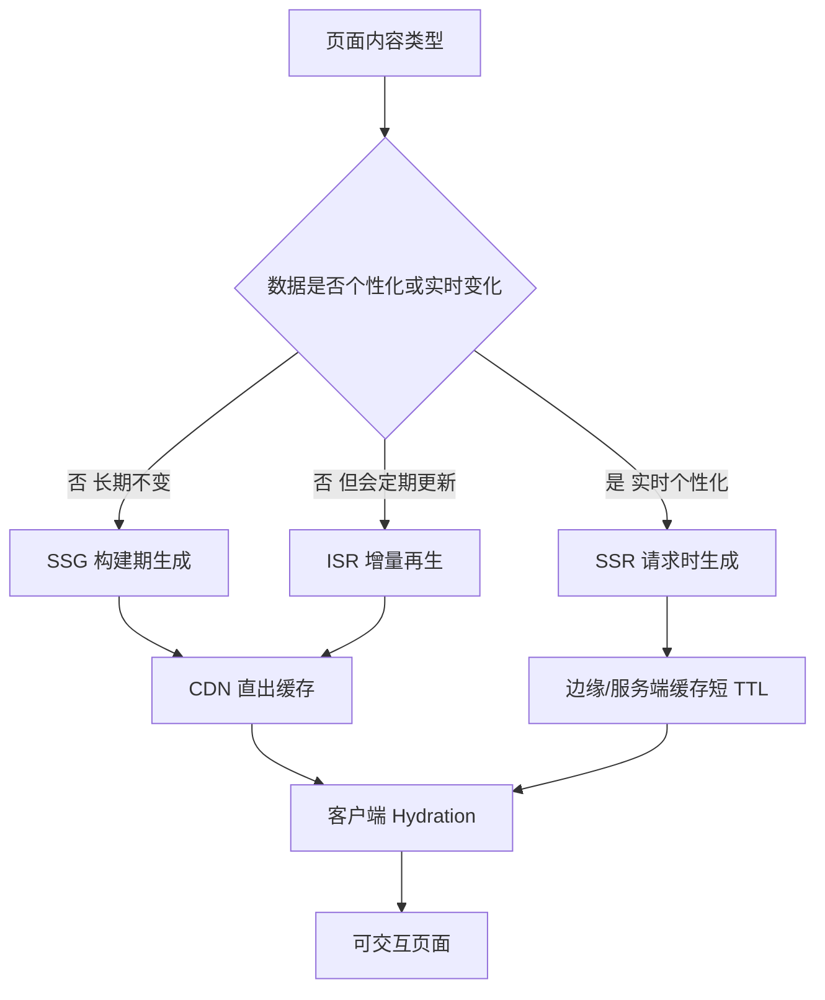

## OPT-027：SSR、SSG、ISR 如何选型？落地要点有哪些？

**答**：
- SSG（构建期生成 HTML）：内容静态、SEO 强诉求的首选，CDN 直出、最快最稳，如博客/文档/营销页。
- SSR（请求时生成）：个性化、实时性数据页面；要警惕服务器成本与 TTFB 抖动。
- ISR/按需再生：SSG 的"定时/按需过期"版本，兼顾静态速度与内容新鲜度（Next.js `revalidate`）。
- 共同落地要点：客户端 hydration 成本不可忽略（SSR 只省了网络，没省 JS）；做好双端兼容（window 判断）；准备 CSR 降级路径。



```jsx
// 一一对应：Next.js 中三种渲染方式的最小示例
// 1. SSG：构建期生成，数据静态
export async function getStaticProps() {
  const docs = await fetchDocs();
  return { props: { docs } };
}

// 2. ISR：静态生成 + 每 60 秒允许再生一版
export async function getStaticPropsForISR() {
  const list = await fetchProducts();
  return { props: { list }, revalidate: 60 };
}

// 3. SSR：每次请求都执行，拿到个性化数据
export async function getServerSideProps({ req }) {
  const me = await fetchUser(req.cookies.session);
  return { props: { me } };
}

export default function Page({ docs, me }) {
  return <main>{me ? me.name : docs[0]?.title}</main>;
}
```
