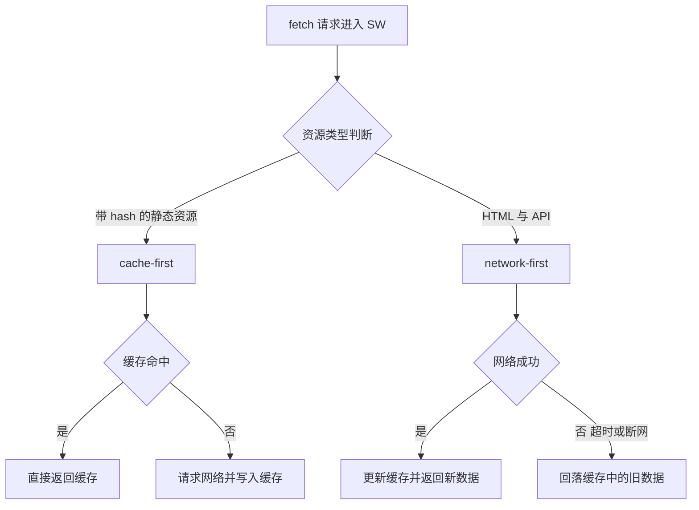

## OPT-029：Service Worker 的缓存策略如何选择？cache-first 与 network-first 实现差异在哪？

**答**：
- cache-first：先查缓存，命中直接返回（连网都不发）——**最快但可能过期**，适合带 hash 的静态资源（immutable）。
- network-first：先发网络请求，成功则更新缓存并返回，失败才回落缓存——**最新鲜但弱网慢**，适合 HTML、API 数据。
- stale-while-revalidate：立即回缓存 + 后台更新——两者折中，适合"次新"内容。
- 落地时用路由匹配把策略分配给不同资源类型，而不是全局一个策略。



```javascript
// 一一对应：手写 cache-first 与 network-first 的实现差异
const CACHE = 'app-v1';

self.addEventListener('fetch', (event) => {
  const { request } = event;
  const url = new URL(request.url);

  if (url.pathname.startsWith('/static/')) {
    // cache-first：命中即回，不发网络
    event.respondWith(
      caches.match(request).then(
        (hit) =>
          hit ||
          fetch(request).then((res) => {
            const copy = res.clone();
            caches.open(CACHE).then((c) => c.put(request, copy));
            return res;
          })
      )
    );
  } else if (request.mode === 'navigate') {
    // network-first：新鲜优先，失败回落缓存
    event.respondWith(
      fetch(request)
        .then((res) => {
          const copy = res.clone();
          caches.open(CACHE).then((c) => c.put(request, copy));
          return res;
        })
        .catch(() => caches.match(request).then((hit) => hit || caches.match('/offline.html')))
    );
  }
});
```
