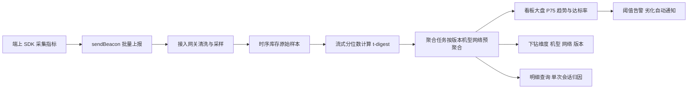

## OPT-047：性能数据看板怎么设计？P75 分位数要怎么算才不出错？

**答**：
- 看板三层：**大盘**（CWV 三指标 P75 + 达标率趋势）、**维度下钻**（机型/网络/地区/版本）、**明细归因**（可回放的单次会话指标 + trace 链接）。
- 分位数必须在**服务端**对原始样本算，前端预聚合再算 P75 是错的；样本量大的链路用 t-digest/CKetch 算法流式合并。
- 均值会掩盖长尾：同一均值下 P50=1s/P99=9s 和 P50=3s/P99=4s 是两个完全不同的产品问题。
- 必须带样本量护栏：分位样本 <100 条置灰不展示，防止小样本抖动误导决策。



```javascript
// 一一对应：服务端流式分位数计算（t-digest 简化版思想，可分布式合并）
class TDigest {
  constructor(delta = 100) {
    this.delta = delta;
    this.centroids = []; // { mean, count }
    this.count = 0;
  }
  add(value, weight = 1) {
    this.centroids.push({ mean: value, count: weight });
    this.count += weight;
    if (this.centroids.length > this.delta * 2) this._compress();
  }
  // 分布式合并：多个节点各算 digest 后 add 相同结构即可，结果仍是全量 P75
  merge(other) {
    other.centroids.forEach((c) => this.add(c.mean, c.count));
  }
  _compress() {
    this.centroids.sort((a, b) => a.mean - b.mean);
    const merged = [];
    for (const c of this.centroids) {
      const last = merged.at(-1);
      if (last && last.count + c.count <= this._limit()) {
        last.mean = (last.mean * last.count + c.mean * c.count) / (last.count + c.count);
        last.count += c.count;
      } else merged.push({ ...c });
    }
    this.centroids = merged;
  }
  _limit() {
    // 每个质心的容量随位置变化，中间粗两端细，保证尾部精度
    const q = arguments[0] ?? this.count / 2;
    return (4 * this.count * q * (1 - q)) / this.delta || 1;
  }
  quantile(q) {
    if (!this.centroids.length) return NaN;
    this._compress();
    const target = q * this.count;
    let acc = 0;
    for (const c of this.centroids) {
      if (acc + c.count >= target) return c.mean;
      acc += c.count;
    }
    return this.centroids.at(-1).mean;
  }
}

// 看板服务用法：每分钟把原始样本喂给 digest，输出 P75 + 样本量护栏
const digest = new TDigest();
samples.forEach((v) => digest.add(v));
console.log({
  p75: Math.round(digest.quantile(0.75)),
  sampleCount: digest.count,
  reliable: digest.count >= 100, // <100 看板置灰
});
```

## 十、网络传输优化
