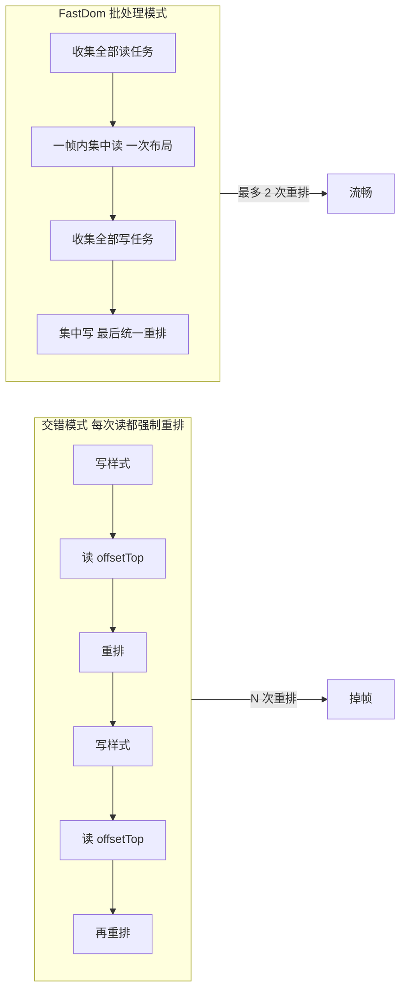

## OPT-065：强制同步布局（Layout Thrashing）怎么实例化定位和批处理修复？

**答**：
- 交替"写布局属性 → 读布局属性"（offsetTop/getBoundingClientRect）会让浏览器每读一次都被迫重排，一帧内 N 次重排即 Thrashing。
- Performance 面板的特征：一帧里密集的紫色 Recalculate Style + 黄色 Layout 交替，调用栈指向你的读布局代码。
- 修复思想（FastDom 模式）：**读和写分成两个队列**，同一帧内先集中读完所有值，再集中写所有变更，读写永远不交错。
- 进阶：读操作缓存（同一帧重复读同值只读一次）、必要时用 transform 替代会触发布局的属性。



```javascript
// 一一对应：Layout Thrashing 复现 + FastDom 思想的读写队列实现
// 反例：循环里读写交错，10 个元素 = 10 次强制重排
function thrash(items) {
  items.forEach((el) => {
    const top = el.offsetTop;        // 读：被迫立即重排
    el.style.top = `${top + 10}px`;  // 写：使下一轮读失效
  });
}

// 修复：读写分离队列（FastDom 核心，约 30 行）
const fastdom = {
  reads: [], writes: [],
  measure(fn) { this.reads.push(fn); this._schedule(); },
  mutate(fn) { this.writes.push(fn); this._schedule(); },
  _scheduled: false,
  _schedule() {
    if (this._scheduled) return;
    this._scheduled = true;
    requestAnimationFrame(() => {
      this._scheduled = false;
      const reads = this.reads.splice(0);  // 阶段一：清空读队列，此时布局只算一次
      reads.forEach((fn) => fn());
      const writes = this.writes.splice(0); // 阶段二：集中写，浏览器最后统一重排
      writes.forEach((fn) => fn());
    });
  },
};

// 业务侧只管声明意图，顺序由队列保证
items.forEach((el) => {
  fastdom.measure(() => { el._top = el.offsetTop; });            // 先全读
  fastdom.mutate(() => { el.style.transform = `translateY(${el._top + 10}px)`; }); // 后全写
});
// 收益：10 次重排 -> 2 次（读一次、写一次），列表越长收益越大
```
