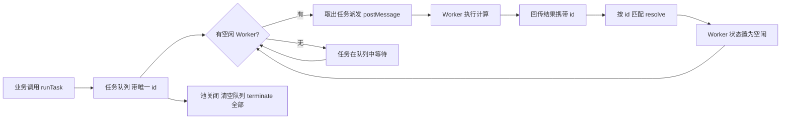

## OPT-099：Worker 池怎么封装？任务队列 + 复用的完整实现是什么？

**答**：
- 单 Worker 一次只能跑一个任务，多核机器应该开 `navigator.hardwareConcurrency`（封顶 4-8）个 Worker 组成池，任务排队、空闲领取。
- 池的三个组件：**任务队列**（优先级 FIFO）、**Worker 复用**（避免频繁构造销毁的启动成本）、**Promise 化接口**（业务无感知 id 匹配请求响应）。
- 关键细节：任务带唯一 id，Worker 回传 id 关联 resolve；Worker 崩溃要能重新拉起并重投任务；池关闭时先清队列再 terminate。
- 适用判断：任务数 > Worker 数且单任务 >10ms 才需要池；偶发单次计算直接开一个 Worker 更简单。



```javascript
// 一一对应：Worker 池完整实现（队列 + 复用 + Promise 化 + 崩溃重启）
class WorkerPool {
  constructor(workerScript, size = Math.min(navigator.hardwareConcurrency || 2, 8)) {
    this.queue = [];
    this.idle = [];
    this.busy = new Map(); // worker -> taskId
    this.pending = new Map(); // taskId -> { resolve, reject }
    for (let i = 0; i < size; i++) this.idle.push(this._spawn(workerScript));
  }
  _spawn(script) {
    const w = new Worker(script);
    w.onmessage = (e) => {
      const { id, ok, result, error } = e.data;
      const p = this.pending.get(id);
      this.pending.delete(id);
      ok ? p.resolve(result) : p.reject(new Error(error));
      this.idle.push(w);          // 归还空闲池
      this._dispatch();           // 立即补位下一个任务
    };
    w.onerror = () => {           // 崩溃自愈：重建 Worker，队列任务自动重投
      this.idle = this.idle.filter((x) => x !== w);
      this.idle.push(this._spawn(w.src || 'worker.js'));
      this._dispatch();
    };
    return w;
  }
  run(payload, transfer = []) {
    return new Promise((resolve, reject) => {
      const id = crypto.randomUUID();
      this.pending.set(id, { resolve, reject });
      this.queue.push({ id, payload, transfer });
      this._dispatch();
    });
  }
  _dispatch() {
    while (this.idle.length && this.queue.length) {
      const task = this.queue.shift();
      const w = this.idle.pop();
      w.postMessage({ id: task.id, data: task.payload }, task.transfer);
    }
  }
  destroy() {
    this.queue.length = 0;
    this.pending.forEach((p) => p.reject(new Error('pool destroyed')));
    this.idle.forEach((w) => w.terminate());
  }
}

// 使用：8 核机器并行处理 100 张图
const pool = new WorkerPool('worker.js');
const results = await Promise.all(
  imageBuffers.map((buf) => pool.run(buf, [buf])) // buffer 转移进 Worker 零拷贝
);
```
