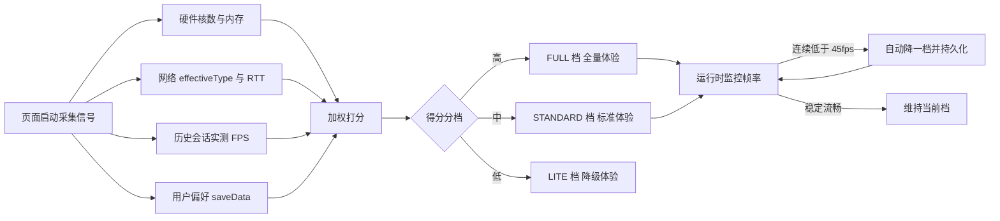

## OPT-111：低端机画像与自适应降级怎么做？设备分档怎么实现？

**答**：
- 分档信号四类：硬件（`navigator.hardwareConcurrency`、`navigator.deviceMemory`）、实测（首帧耗时、上次会话的 FPS 统计）、网络（effectiveType/RTT）、用户设置（saveData/reduced-motion）。
- 分档决策：单信号都会误判（8 核 CPU 也能配 1G 内存），**多信号加权打分**后分三档：FULL/STANDARD/LITE。
- 降档动作清单：LITE 档关动画/换静态图、虚拟列表步长加大、禁用毛玻璃与阴影、埋点采样率提高（省 CPU）、接口裁剪。
- 档位可被运行时修正：实测 FPS 连续低于阈值自动降档（见 OPT-109 思想），持久化到 localStorage。



```javascript
// 一一对应：设备分档打分 + 降级动作应用
function detectTier() {
  const signals = [];
  // 信号 1：硬件核数与内存（低配各扣分）
  const cores = navigator.hardwareConcurrency ?? 4;
  const mem = navigator.deviceMemory ?? 4; // GB，Safari 不支持默认中档
  signals.push(cores <= 4 ? 0 : cores <= 6 ? 1 : 2);
  signals.push(mem <= 2 ? 0 : mem <= 4 ? 1 : 2);
  // 信号 2：网络
  const conn = navigator.connection ?? {};
  signals.push(['slow-2g', '2g'].includes(conn.effectiveType) ? 0 : conn.effectiveType === '3g' ? 1 : 2);
  // 信号 3：历史实测（上一会话 FPS 由监控写入）
  const lastFps = Number(localStorage.getItem('lastSessionFps') ?? 60);
  signals.push(lastFps < 40 ? 0 : lastFps < 55 ? 1 : 2);
  // 信号 4：用户偏好
  if (navigator.connection?.saveData || matchMedia('(prefers-reduced-motion: reduce)').matches) {
    return 'LITE'; // 用户主动省流/减动效：直接最低档
  }
  const score = signals.reduce((a, b) => a + b, 0); // 满分 8
  return score >= 7 ? 'FULL' : score >= 4 ? 'STANDARD' : 'LITE';
}

const TIER_ACTIONS = {
  FULL: { animations: true, blur: true, imageQuality: 'high', listStep: 1 },
  STANDARD: { animations: true, blur: false, imageQuality: 'medium', listStep: 1 },
  LITE: { animations: false, blur: false, imageQuality: 'low', listStep: 2 },
};
function applyTier(tier) {
  const cfg = TIER_ACTIONS[tier];
  const root = document.documentElement;
  root.dataset.tier = tier;
  root.classList.toggle('no-anim', !cfg.animations); // CSS: .no-anim * { animation: none !important; }
  root.classList.toggle('no-blur', !cfg.blur);       // CSS: .no-blur [class*=blur] { backdrop-filter: none; }
  return cfg; // imageQuality 决定图片 URL 档位，listStep 决定虚拟列表/分页步长
}
const tier = applyTier(detectTier());
console.log('当前设备档位:', tier);
```
