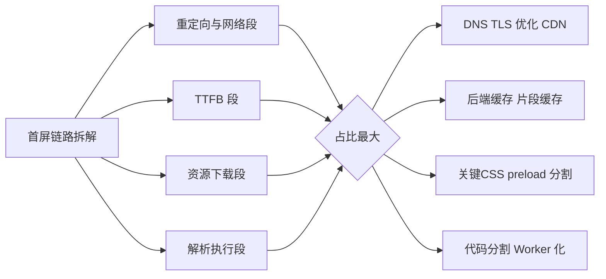

## OPT-121：首屏慢如何做"关键链路拆解"，从 TTFB 到 FCP 逐段归因？

**答**：
- 首屏链路 = 重定向 → DNS/TCP/TLS → 请求发出 → TTFB（后端+网络）→ HTML 下载 → 资源发现与下载 → 解析执行 → FCP。用 `PerformanceNavigationTiming` 把每段耗时精确拆出。
- 归因口诀：TTFB 占比高→后端/CDN；responseEnd 到资源加载慢→资源阻塞；loadEventEnd 后仍白屏→JS 执行或渲染阻塞。
- 逐段算占比画瀑布，先打占比最大的一段，避免"感觉是图片问题"式的经验主义优化。
- 线上采样上报各分段，用 P75 看分布而不是均值。



```javascript
// 一一对应：用 PerformanceNavigationTiming 把 TTFB→FCP 拆成 8 段并上报
function reportFirstScreenBreakdown() {
  const [nav] = performance.getEntriesByType('navigation');
  if (!nav) return;
  const seg = {
    redirect: nav.redirectEnd - nav.redirectStart,
    dns: nav.domainLookupEnd - nav.domainLookupStart,
    tcp_tls: nav.connectEnd - nav.connectStart,
    ttfb: nav.responseStart - nav.requestStart,       // 后端处理+网络回程
    html_download: nav.responseEnd - nav.responseStart,
    resource_gap: nav.domContentLoadedEventStart - nav.responseEnd, // 资源发现+下载
    parse_exec: nav.domContentLoadedEventEnd - nav.domContentLoadedEventStart,
    until_fcp: 0,
  };
  const fcp = performance.getEntriesByName('first-contentful-paint')[0];
  if (fcp) seg.until_fcp = fcp.startTime - nav.domContentLoadedEventEnd;
  // 归因建议：先修占比最大的段
  const max = Object.entries(seg).sort((a, b) => b[1] - a[1])[0];
  navigator.sendBeacon('/api/perf', JSON.stringify({
    type: 'fcp_breakdown', url: location.pathname, seg,
    bottleneck: max[0], bottleneck_ms: Math.round(max[1]),
  }));
}
addEventListener('load', () => setTimeout(reportFirstScreenBreakdown, 0));
```
