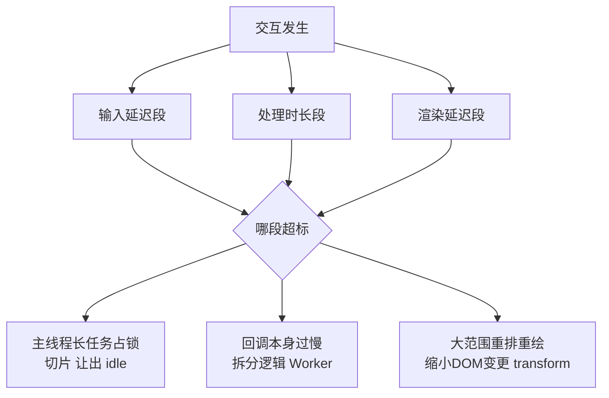

## OPT-129：INP 不达标如何做"输入延迟 / 处理时长 / 渲染延迟"三段归因？

**答**：
- INP = 每次交互从 input 到下一帧绘制完成的总时长，Event Timing API 的 `interactionId` 能把一次交互拆成三段：inputDelay（事件排队）、processing（回调执行）、presentationDelay（渲染提交）。
- 归因经验值：inputDelay 高→主线程被长任务占住，治理长任务；processing 高→回调本身慢，拆分/瘦身事件处理；presentationDelay 高→回调触发了大范围重排重绘，减少 DOM 变更范围。
- 上报时记录交互目标（按钮文案/选择器）与三段耗时，P75 聚合后直接给出"哪类交互、哪一段"是瓶颈。
- 长任务治理三板斧：`scheduler.yield()`/`setTimeout` 切片、把非紧急逻辑挪 requestIdleCallback、重计算进 Worker。



```javascript
// 一一对应：INP 三段归因上报（interactionId + duration 三段拆分）
const interactions = new Map(); // interactionId -> 最大的一次事件计时

new PerformanceObserver(list => {
  for (const e of list.getEntries()) {
    if (!e.interactionId) continue;
    const prev = interactions.get(e.interactionId);
    if (!prev || e.duration > prev.duration) {
      const inputDelay = e.startTime - (e.processingStart ?? e.startTime);
      const processing = (e.processingEnd ?? 0) - e.processingStart;
      interactions.set(e.interactionId, {
        duration: e.duration,
        target: e.target?.tagName + (e.target?.textContent || '').slice(0, 12),
        inputDelay: Math.round(inputDelay),       // 段1 排队等待
        processing: Math.round(processing),       // 段2 回调执行
        presentation: Math.round(e.duration - inputDelay - processing), // 段3 渲染提交
      });
    }
  }
}).observe({ type: 'event', durationThreshold: 40, buffered: true });

addEventListener('pagehide', () => {
  const worst = [...interactions.values()].sort((a, b) => b.duration - a.duration).slice(0, 5);
  navigator.sendBeacon('/api/perf/inp', JSON.stringify({ worst }));
});

// 治理模板：回调切片，把长处理拆成多次让出主线程
async function handleSubmit(items) {
  for (const it of items) {
    processOne(it);                       // 每次处理一小块
    if (scheduler?.yield) await scheduler.yield();  // 让出，避免 inputDelay 上涨
    else await new Promise(r => setTimeout(r));
  }
}
```
