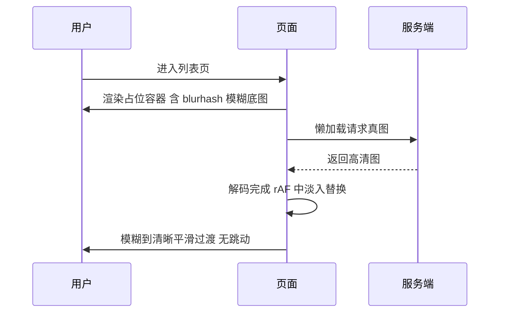

## OPT-152：图片渐进加载链路（LQIP/blurhash）怎么设计与落地？

**答**：
- 渐进加载链路：HTML 先渲染占位（纯色/微缩图）→ 加载超小 LQIP（20×13，200B 内）或 blurhash 字符串 → 解码成模糊底图 → 真图到达后淡入替换。
- LQIP：构建期对每张图生成 base64 微缩图内联进 HTML/CSS，零额外请求；blurhash：只存一个短字符串（30~40 字符），canvas 解码出模糊图，体积比 LQIP 更小、质量更稳。
- 关键细节：真图 `loading="lazy"` 且带尺寸占位防 CLS；替换用 opacity 过渡；blurhash 解码放 rAF/idle，避免大图列表同时解码卡主线程。
- 选型：静态站点 LQIP（构建期一次生成）；动态列表/用户上传用 blurhash（后端上传时算好哈希随接口下发）。



```javascript
// 一一对应：blurhash 渐进加载图片组件（React 版）
import { Blurhash } from 'react-blurhash';
import { useState, useEffect } from 'react';

function ProgressiveImage({ hash, src, width, height, alt }) {
  const [loaded, setLoaded] = useState(false);
  return (
    <div style={{ aspectRatio: `${width}/${height}`, position: 'relative', overflow: 'hidden' }}>
      {/* 阶段1：blurhash 解码为模糊底图，只有 30 字符数据 */}
      <div style={{ position: 'absolute', inset: 0, opacity: loaded ? 0 : 1, transition: 'opacity .3s' }}>
        <Blurhash hash={hash} widthPct={100} heightPct={100} resolutionX={32} resolutionY={32} />
      </div>
      {/* 阶段2：真图懒加载 + 异步解码，完成后淡入盖住模糊层 */}
       requestAnimationFrame(() => setLoaded(true))}  // 解码后再淡入
        style={{ position: 'absolute', inset: 0, width: '100%', height: '100%',
                 objectFit: 'cover', opacity: loaded ? 1 : 0, transition: 'opacity .3s' }}
      />
    </div>
  );
}
// 数据侧：后端上传图片时生成 hash 一并返回
// { id: 1, url: '.../img-800.webp', w: 800, h: 533, blurhash: 'L6H2:3of00j[~qofWBj[00j[%Mof' }
```
