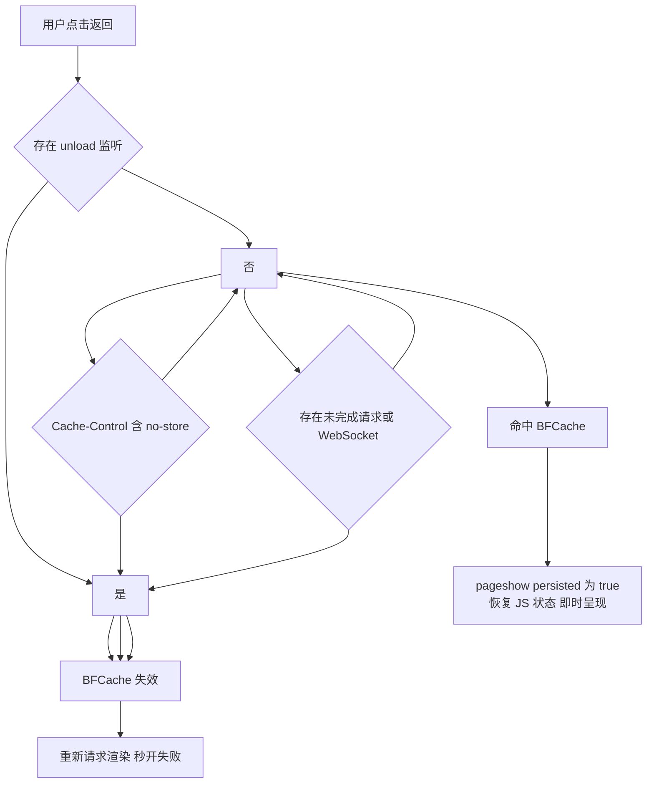

## OPT-181：BFCache 的命中条件是什么？线上命中率低如何排查？

**答**：
- BFCache（往返缓存）：返回上一页时浏览器直接恢复内存中的整页快照，秒开且保留 JS 状态；对"列表→详情→返回"场景的 LCP/返回体验收益巨大。
- 命中条件：同源导航、无 `unload/beforeunload` 监听、无 `Cache-Control: no-store`（Firefox）、无未完成的 fetch/XHR（部分浏览器）、无 WebSocket 打开等；事件面用 `pageshow` 的 `event.persisted` 判定命中。
- 排查低命中率：Chrome DevTools 的 back/forward cache 面板一键检测阻断原因（会列出"unload handler""no-store"等具体原因）；线上用 RUM 统计 `persisted` 比率，按浏览器/页面下钻。
- 常见踩雷：埋点 SDK 注册 unload（改成 pagehide/visibilitychange）、API 响应头 no-store 全局下发、老代码 `window.onunload = cleanup`。



```javascript
// 一一对应：BFCache 兼容改造 + 命中率统计
// 1. 恢复时刷新实时数据（BFCache 里的是"过去"的页面）
addEventListener('pageshow', event => {
  if (event.persisted) {
    // 命中 BFCache：重新拉取可能过期的数据，续上定时器
    refreshStaleData();
    startTimers();
    reportBfCacheHit(true);
  }
});
addEventListener('pagehide', event => {
  // pagehide 在 BFCache 存入时也触发；unload 会阻止缓存，绝不用
  stopTimers();                    // 暂停轮询等，避免后台浪费
  reportBfCacheHit(false);
});

// 2. 排查工具：开发者工具 Application > Back/forward cache 一键检测
// 线上统计命中率：按页面/浏览器下钻
let navCount = 0, hitCount = 0;
addEventListener('pageshow', e => { if (performance.navigation?.type === 2 || e.persisted) navCount++; if (e.persisted) hitCount++; });
setInterval(() => {
  if (navCount) navigator.sendBeacon('/api/metrics/bfcache', JSON.stringify({
    hit_ratio: +(hitCount / navCount).toFixed(3), page: location.pathname,
  }));
}, 60_000);

// 3. 常见阻断修复对照
// X: window.addEventListener('unload', cleanup)   → 改 pagehide
// X: fetch('/api', { keepalive: true }) 未完成期间跳走 → 激活后重新发
// X: Cache-Control: no-store 全局 → 仅用户敏感页下发
// X: opener/打开的 WebSocket 未关 → visibilitychange 时挂起
```
