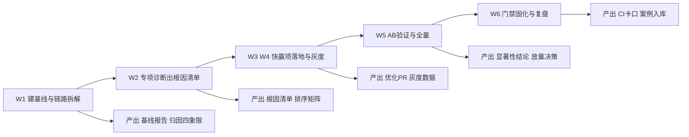

## OPT-185：一次完整性能专项如何推进？给出 6 周 plan 模板。

**答**：
- 阶段划分：W1 建基线与拆解（指标现状、链路归因）→ W2 专项诊断（Top 根因清单）→ W3~W4 快赢改造（P0 项落地+灰度）→ W5 A/B 验证与全量 → W6 门禁固化与复盘。
- 两个关键纪律：①每阶段有 exit criteria（不达标不进下一阶段）；②快赢优先——第 1 周末就开始做"确定性收益"项（preload/压缩），不要憋大改造。
- 组织保障：专项 owner + 各模块接口人 + 数据支持，周会同步进度与风险，风险项（如后端 TTFB）提前升级。
- 复盘沉淀：优化项与实测收益登记进知识库（见 OPT-197），下次专项直接引用弹性系数。



```yaml
# 一一对应：6 周性能专项计划模板（含 exit criteria）
plan: home-page-perf
duration: 6w
owner: front-perf-lead
baseline: { lcp_p75: 4200ms, inp_p75: 280ms, cls_p75: 0.18 }   # W1 开始时锁定

phases:
  - week: 1
    name: 建基线与拆解
    actions: [RUM 基线报告, 关键链路拆解见 OPT-121, 归因四象限见 OPT-163]
    exit_criteria: { report: 基线+四象限占比完成 }

  - week: 2
    name: 专项诊断
    actions: [Top10 慢会话回放分析, 根因清单与收益成本矩阵]
    exit_criteria: { output: 根因清单 ≥ 8 项且完成 P0 圈定 }

  - week: 3
    name: 快赢改造一
    actions: [首图 preload, 关键CSS 内联, 接口并行化]
    exit_criteria: { lab_lcp_delta: -800ms }

  - week: 4
    name: 快赢改造二与灰度
    actions: [SSR 片段缓存 5% 灰度, INP 长任务切片]
    exit_criteria: { gray_lcp_p75: -1000ms, error_rate: "<0.1%" }

  - week: 5
    name: AB 验证与全量
    actions: [50/50 AB 见 OPT-166, 护栏指标监控, 全量发布]
    exit_criteria: { ab_significant: true, lcp_p75_target: 2800ms }

  - week: 6
    name: 固化与复盘
    actions: [Lighthouse CI 卡口上线见 OPT-040, 案例入库 OPT-197, 复盘会]
    exit_criteria: { ci_gate: enabled, doc: 复盘报告+弹性系数入库 }
```
