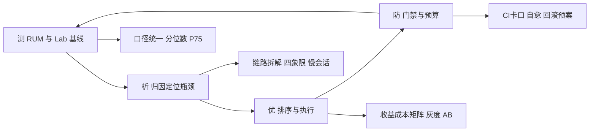

## OPT-200：把性能优化方法论收束为"测→析→优→防"闭环，如何落地？

**答**：
- 四环定义：**测**（RUM+Lab 双体系基线，口径统一 OPT-167）→ **析**（归因定位瓶颈，OPT-121/163）→ **优**（收益/成本排序执行，OPT-184）→ **防**（门禁+预算+自愈防劣化，OPT-187/192）。闭环的意义在"防"：没有防的优化会在业务迭代中回吐。
- 团队成熟度阶梯：L0 救火式 → L1 有数据 → L2 有专项 → L3 有门禁 → L4 有文化（OPT-120），每年评估一次往哪级走。
- 落地载体：性能平台（数据）、知识库（经验）、CI（规则）、流程（评审/复盘），四者缺一不可。
- 收束一句话：性能优化不是项目而是能力——量得准（测）、找得准（析）、改得动（优）、守得住（防）。



```javascript
// 一一对应：四环闭环自检脚本（季度跑一次，输出团队成熟度得分）
const maturity = {
  测: [
    ['RUM 覆盖核心页面', () => rumCoverage() > 0.95],
    ['指标口径字典存在且被引用', () => !!metricRegistry && registryRefs() > 5],
    ['分位数看板而非均值', () => dashboards.some(d => d.usesP75)],
  ],
  析: [
    ['关键链路拆解自动化', () => !!breakdownReport],
    ['归因四象限季度产出', () => quadrantReportsThisQuarter() >= 1],
  ],
  优: [
    ['优化项有收益/成本评分', () => roadmapItems.every(i => i.score != null)],
    ['改动有 A/B 或灰度验证', () => lastExperimentsSignificantRatio() > 0.8],
  ],
  防: [
    ['CI 性能门禁阻塞生效', () => ciGateEnabled && falsePositiveRate() < 0.1],
    ['预算矩阵覆盖所有端', () => budgetMatrix.keys().length >= ends.length],
    ['白屏/异常自愈上线', () => selfHealEnabled],
  ],
};

function evaluate() {
  const result = {};
  for (const [ring, checks] of Object.entries(maturity)) {
    const passed = checks.filter(([, fn]) => fn()).length;
    result[ring] = `${passed}/${checks.length}`;
  }
  const level = Object.values(result).every(s => s.startsWith(s.length && '3') ) ? 'L4'
    : result.防 === '3/3' ? 'L3'
    : result.析 === '2/2' ? 'L2'
    : result.测 !== '0/3' ? 'L1' : 'L0';
  return { rings: result, level, next: SUGGEST_NEXT[level] };
}
const SUGGEST_NEXT = {
  L0: '先建 RUM 基线（测）', L1: '做链路拆解与首次专项（析/优）',
  L2: '上门禁与预算（防）', L3: '机制进流程与激励（文化）', L4: '保持节奏，季度复评',
};
console.table(evaluate());
```
