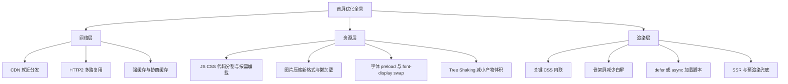

## PER-024：首屏性能优化有哪些手段？请给出一张全景图和一个落地示例。

**答**：
- 网络层：CDN 就近分发、HTTP/2、强缓存与协商缓存、TTFB 优化。
- 资源层：代码分割按需加载、图片压缩与懒加载、字体 preload、Tree Shaking 减小 bundle。
- 渲染层：关键 CSS 内联、骨架屏、defer/async 脚本、SSR 或预渲染兜底。
- 度量闭环：以 LCP/FCP 为北极星指标，上线后用 RUM 数据回归验证。



```html
<!-- 首屏优化组合拳：一个典型的 index.html -->
<head>
  <meta charset="utf-8">
  <!-- 1. 网络层：关键源提前握手，关键资源提前预载 -->
  <link rel="preconnect" href="https://api.example.com">
  <link rel="preload" href="/css/critical.css" as="style">
  <link rel="preload" href="/img/hero.avif" as="image">
  <!-- 2. 渲染层：关键 CSS 内联，剩余样式异步 -->
  <style>.header{display:flex}.hero{min-height:60vh}</style>
  <link rel="stylesheet" href="/css/main.css" media="print" onload="this.media='all'">
  <!-- 3. 骨架屏占位：减少白屏体感与布局偏移 -->
  <style>.skeleton{background:#eee;animation:pulse 1s infinite}</style>
</head>
<body>
  <div class="skeleton hero"></div>
  <!-- 4. defer：不阻塞解析，DOMContentLoaded 前按序执行 -->
  <script src="/js/app.js" defer></script>
</body>
```
