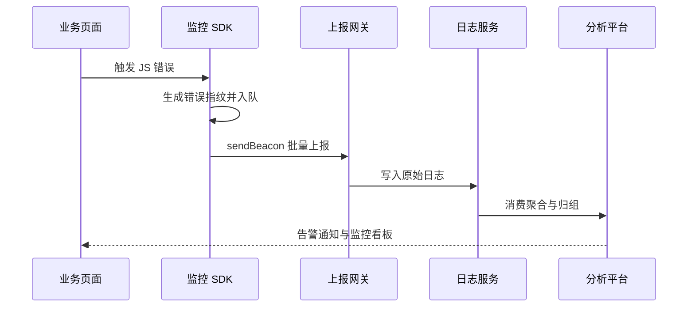

## PER-037：请描述一个错误监控的完整上报链路，并说明前端如何做批量上报。

**答**：
- 链路：页面捕获错误 -> SDK 生成错误指纹入队 -> 批量通过 sendBeacon 发到上报网关 -> 网关写日志服务（如 Kafka + ELK）-> 聚合平台按指纹归组 -> 告警与看板。
- 前端批量策略：队列满 N 条或定时到点就 flush；页面进入 hidden 状态时用 sendBeacon 兜底冲队列，防止数据丢失。
- 上报要限流去重：同一错误指纹短时间只报一次，避免异常风暴打爆网关。
- 网关要做无鉴权的轻量接收 + 削峰，采集侧绝不能影响业务页性能。



```javascript
// 错误监控上报：采集 -> 入队 -> 批量上报 -> 页面隐藏时兜底冲队列
class Reporter {
  constructor(url, { maxBatch = 10, interval = 5000 } = {}) {
    this.url = url;
    this.queue = [];
    this.maxBatch = maxBatch;
    setInterval(() => this.flush(), interval);
    // 页面进入 hidden 时用 sendBeacon 冲队列，防止数据丢失
    document.addEventListener('visibilitychange', () => {
      if (document.visibilityState === 'hidden') this.flush(true);
    });
  }
  push(log) {
    this.queue.push({ ...log, ts: Date.now() });
    if (this.queue.length >= this.maxBatch) this.flush();
  }
  flush(beacon = false) {
    if (!this.queue.length) return;
    const batch = JSON.stringify(this.queue);
    this.queue = [];
    if (beacon && navigator.sendBeacon) {
      navigator.sendBeacon(this.url, new Blob([batch], { type: 'application/json' }));
    } else {
      fetch(this.url, { method: 'POST', body: batch, keepalive: true }).catch(() => {});
    }
  }
}
```
