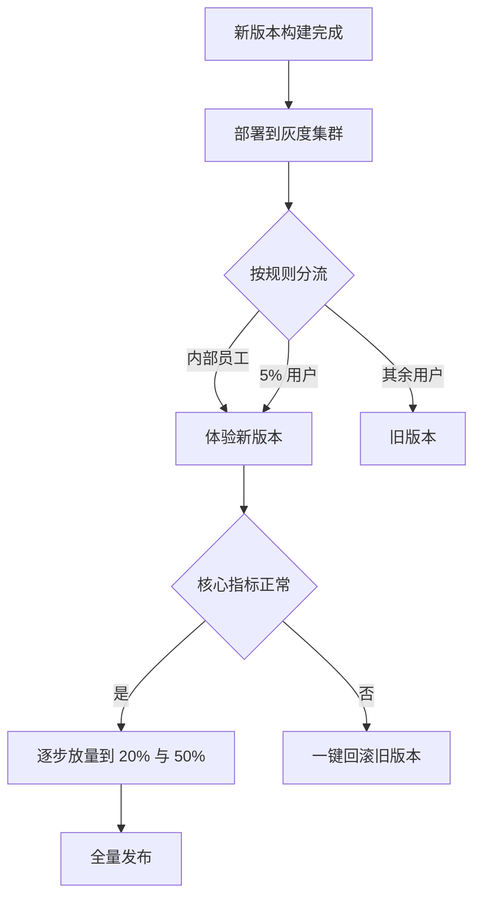

## PER-050：前端灰度发布有哪些方案？完整流程是怎样的？

**答**：
- 接入层灰度：nginx 按 cookie/header/IP/权重分流到新旧集群，用户无感。
- 静态资源灰度：新旧两套构建产物分目录部署，按规则决定 index.html 指向哪一套。
- 应用层灰度：配置中心下发灰度开关，前端按开关启用新功能。
- 完整流程：部署灰度集群 -> 小流量验证（内部员工、5% 用户）-> 盯监控指标（错误率、LCP、转化）-> 逐步放量 -> 异常一键回滚。



```nginx
# 接入层灰度：按 cookie 决定流量进新旧集群
map $cookie_gray $backend {
    default old_pool;
    "on"    new_pool;
}

upstream old_pool { server 10.0.0.1:8080; }
upstream new_pool { server 10.0.0.2:8080; }

server {
    listen 80;
    server_name example.com;

    location / {
        proxy_pass http://$backend;
    }
}
```

## 九、性能指标深水区
