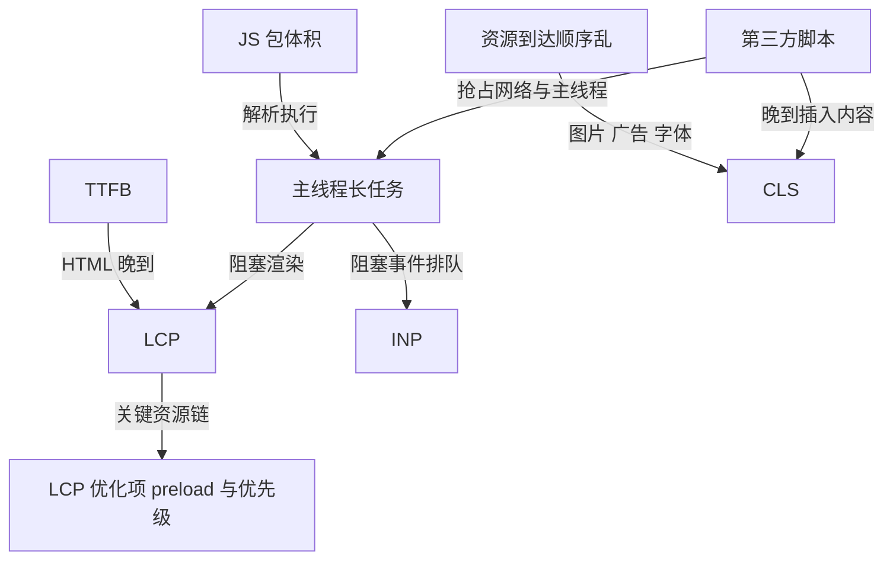

## PER-057：LCP/INP/CLS/TTFB 之间是什么因果关系？如何用图谱指导优化顺序？

**答**：
- TTFB 是一切的起点：TTFB 慢会直接推迟 HTML 到达，进而推迟 LCP；LCP 元素若是 JS 渲染的，则打包体积、长任务都会通过“资源加载”传导到 LCP。
- INP 与 LCP 抢同一条主线程：首屏大量初始化 JS 会同时恶化 LCP（渲染延迟）和 INP（输入延迟），所以两者常一起劣化，一起被“拆长任务 + 懒加载”修复。
- CLS 与加载时序强相关：资源到达顺序乱（图片/广告/字体）产生偏移，与网速相关但不直接由 TTFB 决定。
- 优化顺序按图谱自上而下：先看 TTFB 与传输，再看关键资源链，再看主线程任务，最后收 CLS 与 INP 的细节。



```javascript
// 按因果图谱输出的诊断建议：根据各指标分位数决定先修哪条链路
function diagnose({ ttfbP75, lcpP75, inpP75, clsP75 }) {
  const plan = [];
  if (ttfbP75 > 800) plan.push('TTFB 超标 - 先做 CDN 缓存与重定向清理，收益传导到 LCP');
  if (lcpP75 > 2500 && ttfbP75 <= 800) plan.push('LCP 超标但 TTFB 健康 - 排查关键资源链与优先级');
  if (inpP75 > 200) plan.push('INP 超标 - 拆长任务、事件处理瘦身，与 LCP 共用主线程');
  if (clsP75 > 0.1) plan.push('CLS 超标 - 检查图片宽高、广告占位、字体替换');
  return plan.length ? plan : ['全指标达标 - 转入防劣化监控'];
}
console.log(diagnose({ ttfbP75: 900, lcpP75: 3100, inpP75: 240, clsP75: 0.05 }));
```

## 十、XSS 深水区
