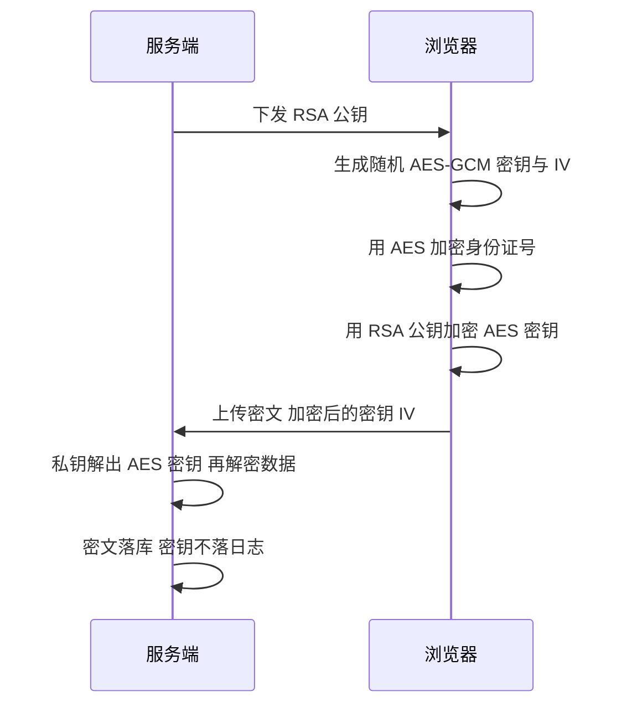

## PER-073：前端加密的边界在哪里？RSA + AES 混合加密怎么实现？

**答**：
- 边界认知：浏览器端加密**密钥必然在客户端出现**，只能防“链路窃听”与“日志明文”，防不了页面内的恶意脚本与逆向；真正的机密保护要靠 HttpOnly、服务端逻辑与 HSM。
- 混合加密动机：RSA 慢且有长度限制，AES 快但密钥分发难；标准做法是**每次会话随机 AES-GCM 密钥加密数据，RSA 公钥只加密这把 AES 密钥**。
- 细节：AES 用 GCM 模式（带认证），IV 随机且不重复；RSA 用 OAEP 填充，不用 PKCS1 v1.5 老填充。
- 与 HTTPS 的关系：HTTPS 已解决传输加密，应用层加密是叠加项，用于满足等保/合规的“传输以外的落库前加密”或敏感字段脱敏链路。



```javascript
// 混合加密：WebCrypto 实现 RSA-OAEP + AES-GCM
async function encryptSensitive(plaintext, rsaPublicKeyPem) {
  // 1) 一次性 AES-GCM 密钥与 IV
  const aesKey = await crypto.subtle.generateKey({ name: 'AES-GCM', length: 256 }, true, ['encrypt']);
  const iv = crypto.getRandomValues(new Uint8Array(12));

  // 2) 数据用 AES-GCM 加密
  const cipher = await crypto.subtle.encrypt(
    { name: 'AES-GCM', iv },
    aesKey,
    new TextEncoder().encode(plaintext),
  );

  // 3) AES 密钥导出后用 RSA-OAEP 公钥加密
  const rawAes = await crypto.subtle.exportKey('raw', aesKey);
  const rsaKey = await importRsaPublicKey(rsaPublicKeyPem); // PEM 转 CryptoKey
  const encKey = await crypto.subtle.encrypt({ name: 'RSA-OAEP' }, rsaKey, rawAes);

  return {
    data: bufToBase64(cipher),
    key: bufToBase64(encKey),   // 只有私钥能解开
    iv: bufToBase64(iv),
  };
}

encryptSensitive('110101199001011234', PUBLIC_KEY_PEM); // 身份证等敏感字段上送前加密
```
