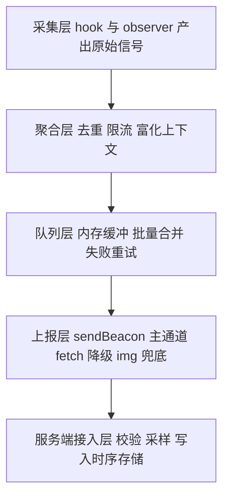

## PER-099：监控 SDK 的四层架构是什么？各层职责如何划分？

**答**：
- 经典四层：**采集层**（hook 各类事件产出原始信号）、**聚合层**（去重、限流、富化上下文）、**队列层**（缓冲、批量、失败重试）、**上报层**（sendBeacon/fetch 多通道降级）。
- 分层的收益：每层可独立测试与替换，采集变更不影响传输，队列在弱网下保数据。
- 关键设计点：采集层**永远不能抛错**（所有 hook 包 try-catch）；聚合层做会话内去重（同一错误指纹只报 N 次）；队列层有内存上限防反噬。
- SDK 自身要监控：上报成功率、SDK 内部错误数，避免“监控自己挂了没人知道”。



```javascript
// SDK 骨架：四层独立实现，主入口只做装配
class MonitorSDK {
  constructor(config) {
    this.collector = new Collector(this.handle.bind(this)); // 采集层
    this.aggregator = new Aggregator(config);               // 聚合层
    this.queue = new Queue({ maxSize: 50, flushMs: 3000 }); // 队列层
    this.transport = new Transport(config.endpoint);        // 上报层
    this.queue.onFlush = (items) => this.transport.send(items);
  }
  handle(raw) {
    try {
      const event = this.aggregator.process(raw); // 去重与富化
      if (event) this.queue.push(event);
    } catch (e) { /* SDK 自身错误静默，绝不能影响业务 */ }
  }
}

// 采集层：所有 hook 包 try-catch，SDK 挂了不能带崩页面
class Collector {
  constructor(emit) {
    this.emit = emit;
    this.safe = (fn) => (...args) => { try { fn(...args); } catch {} };
    this.safe(() => this.observeErrors())();
    this.safe(() => this.observePerformance())();
  }
  observeErrors() {
    window.addEventListener('error', (e) => this.emit({ kind: 'error', msg: e.message, stack: e.error?.stack }), true);
  }
  observePerformance() {
    new PerformanceObserver((l) => l.getEntries().forEach((e) => this.emit({ kind: 'longtask', dur: e.duration })))
      .observe({ type: 'longtask', buffered: true });
  }
}
```
