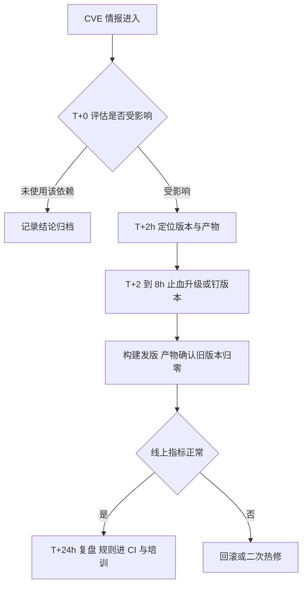

## PER-106：CVE 爆出后的 24 小时应急 SOP 是什么？

**答**：
- 时间线倒排：**T+0~2h 影响评估**（我们是否用了该包、哪个版本、在哪些产物里）、**T+2~8h 止血**（升级/override 钉版本/热修）+ 发版、**T+8~24h 复盘沉淀**（规则进 CI 门禁、案例进培训）。
- 前提建设：依赖清单（SBOM）随每次构建生成并留存，否则评估“我们用没用”就要半天；lockfile 与制品库让排查可以精确到产物版本。
- 止血手段按代价递增：bump patch 版本 -> overrides 强制替换 -> 换替代包 -> 移除功能；发布后验证产物里旧版本归零（`npm ls` 与构建产物 grep 双确认）。
- 复盘重点：为什么 CI 审计没提前拦（新版本发布早于 CVE 公布是常态，重点是响应速度而非预防全部）。



```bash
#!/bin/bash
# CVE 应急脚本：评估 + 钉版本 + 验证
set -euo pipefail
PKG="$1"        # 例如 minimist
SAFE="$2"       # 例如 1.2.8

# 1) 影响面评估：lockfile 中谁依赖了它
echo "== 依赖方 =="
npm ls "$PKG" --all || true
grep -c "\"$PKG\"" package-lock.json || true

# 2) 止血：overrides 钉到安全版本并重装
node -e "
const fs = require('fs');
const p = JSON.parse(fs.readFileSync('package.json', 'utf8'));
p.overrides = { ...p.overrides, ['${PKG}@<${SAFE}']: '>=${SAFE}' };
fs.writeFileSync('package.json', JSON.stringify(p, null, 2) + '\n');
console.log('overrides 已写入', PKG_SAFE_MAP = '${PKG}@<${SAFE} -> >=${SAFE}');
"
rm -rf node_modules package-lock.json && npm install --package-lock-only && npm ci --ignore-scripts

# 3) 验证：lockfile 与 node_modules 双确认版本归位
npm ls "$PKG"
grep -c "\"$PKG\": \"版本.*${SAFE}" package-lock.json && echo "OK: 已钉到安全版本" || echo "WARN: 仍有旧版本残留"
```
