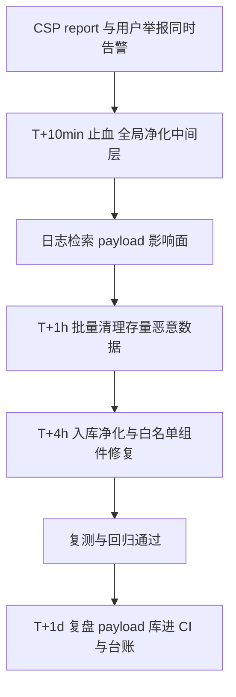

## PER-112：请完整复盘一次存储型 XSS 事件：从发现到修复的全流程。

**答**：
- 背景与发现：评论接口富文本未净化，攻击者提交 `` payload，CSP report 与用户举报同时触发告警。
- 处置时间线：T+10min 止血（全局渲染入口加净化中间层，恶意内容不再执行）-> T+1h 清数据（批量转义存量 payload）-> T+4h 修复（入库前净化 + 富文本白名单组件）-> T+1d 复盘（payload 库进回归、注入点清单建台账）。
- 影响评估：日志检索 payload 出现次数与受影响会话，评估是否需要强制下线受影响用户。
- 沉淀：所有富文本入口统一走净化 SDK、CSP report 接入 P1 告警、安全单测进 CI。



```javascript
// 修复落地：入库前净化（写）+ 读取兜底（读）双层防线
import DOMPurify from 'dompurify';

// 写侧：服务端与前端共用同一净化配置，入库前强制执行
export const sanitizeForStore = (dirty) => DOMPurify.sanitize(dirty, {
  ALLOWED_TAGS: ['p', 'b', 'i', 'em', 'strong', 'a', 'img', 'br'],
  ALLOWED_ATTR: ['href', 'src', 'alt'],
  FORBID_ATTR: ['style', 'onerror', 'onclick'],
});

// 读侧兜底：历史数据或旁路写入的内容在渲染前再净化一次
export function SafeComment({ html }) {
  return <div className="comment"
    dangerouslySetInnerHTML={{ __html: sanitizeForStore(html) }} />;
}

// 回归测试：payload 库逐条断言净化结果
const payloadCases = [
  '',
  '<script>alert(1)<\/script>',
  '<a href="javascript:alert(1)">x</a>',
  '<svg><animate onbegin=alert(1)>',
];
payloadCases.forEach((p) => {
  const clean = sanitizeForStore(p);
  if (/<(script|svg)|onerror|javascript:/i.test(clean)) {
    throw new Error(`净化不彻底：${p} -> ${clean}`);
  }
});
```
