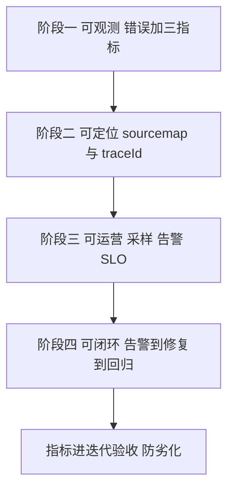

## PER-118：监控体系从 0 到 1 的搭建路线是什么？

**答**：
- 阶段一（1-2 周）**可观测**：接错误监控（window.onerror/Promise）+ 基础性能（web-vitals 三指标），先把“有没有问题”看见。
- 阶段二（2-4 周）**可定位**：sourcemap 还原流水线、traceId 串前后端日志、会话与设备维度下钻。
- 阶段三（1-2 月）**可运营**：采样策略、告警规则与值班轮转、SLO 与错误预算、版本对比看板。
- 阶段四（持续）**可闭环**：告警 -> 定位 -> 修复 -> 回归验证的标准流程，指标作为迭代验收的一部分。



```javascript
// 阶段一的最小可用监控：50 行内跑通“看得见”
import { onLCP, onINP, onCLS } from 'web-vitals';

function report(type, data) {
  navigator.sendBeacon('/api/monitor', JSON.stringify({
    type, data, ts: Date.now(),
    page: location.pathname, ver: __APP_VERSION__,
    session: sessionStorage.getItem('sid') ?? crypto.randomUUID(),
  }));
}

// 1) 错误：JS 异常 + 资源失败 + Promise 拒绝
window.addEventListener('error', (e) => report('error', {
  msg: e.message, src: e.filename, line: e.lineno, stack: e.error?.stack?.slice(0, 2000),
}), true);
window.addEventListener('unhandledrejection', (e) => report('rejection', {
  reason: String(e.reason?.stack ?? e.reason).slice(0, 2000),
}));

// 2) 性能：官方三指标
onLCP((m) => report('lcp', { value: m.value }));
onINP((m) => report('inp', { value: m.value }));
onCLS((m) => report('cls', { value: m.value }));
```
