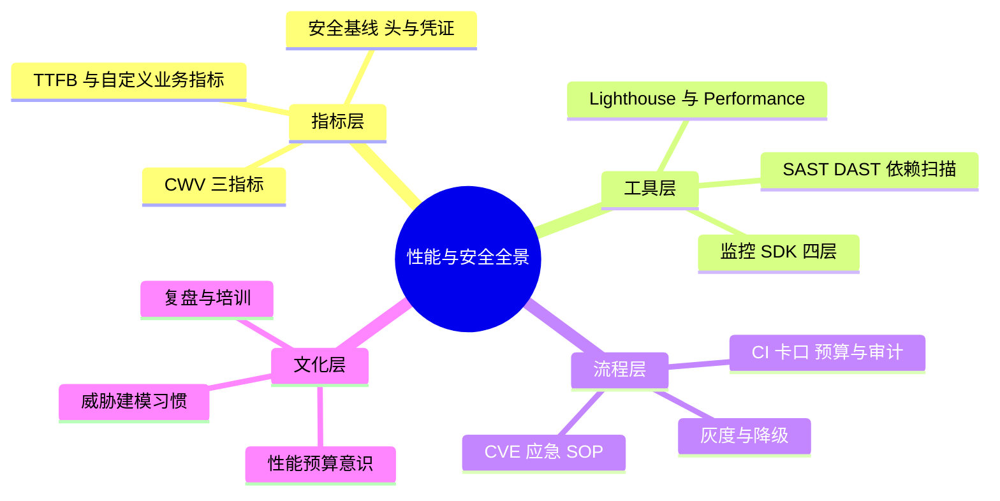

## PER-125：请给出性能与安全知识体系的收束全景图。

**答**：
- 四层收束：**指标层**（CWV + 业务指标 + 安全基线指标定义“什么是好”）、**工具层**（Lighthouse/Performance/监控 SDK/扫描器回答“怎么测”）、**流程层**（CI 卡口 + 应急 SOP + 灰度发布回答“怎么守住”）、**文化层**（预算意识 + 威胁建模习惯 + 复盘机制回答“怎么持续”）。
- 两个主线的交汇点：主线程（长任务既伤 INP 也是 XSS 执行环境）、第三方（性能税与供应链风险同源）、缓存（性能与安全天天打架的地方）。
- 面试表达建议：任何性能/安全问题都按“**指标 -> 工具定位 -> 方案 -> 防劣化**”四段作答，展示体系而非碎片。
- 最终检验：能否把本文件 125 题各自归位到全景图的某个节点，并说清它与其他节点的传导关系。



```json
{
  "knowledge_map": {
    "metrics": {
      "performance": ["LCP", "INP", "CLS", "TTFB", "FPS", "ready_to_order"],
      "security": ["csp_violations", "error_rate", "auth_failure_rate", "slo_burn_rate"]
    },
    "tools": {
      "diagnosis": ["Lighthouse", "DevTools Performance", "Memory", "BFCache 面板"],
      "monitor": ["web-vitals", "rrweb", "sourcemap 流水线", "时序库与告警"],
      "security": ["Semgrep", "gitleaks", "npm audit", "ZAP DAST", "DOMPurify"]
    },
    "process": {
      "quality_gate": ["bundle 预算", "依赖审计", "secrets 扫描", "越权自测"],
      "release": ["灰度放量", "降级预案", "BFCache 兼容", "sourcemap 先传后发"],
      "incident": ["XSS 止血 SOP", "CVE 24h SOP", "错误预算冻结"]
    },
    "culture": ["指标进验收", "威胁建模进设计", "复盘进培训", "预算进看板"]
  }
}
```

## 十九、前端安全编码规范
