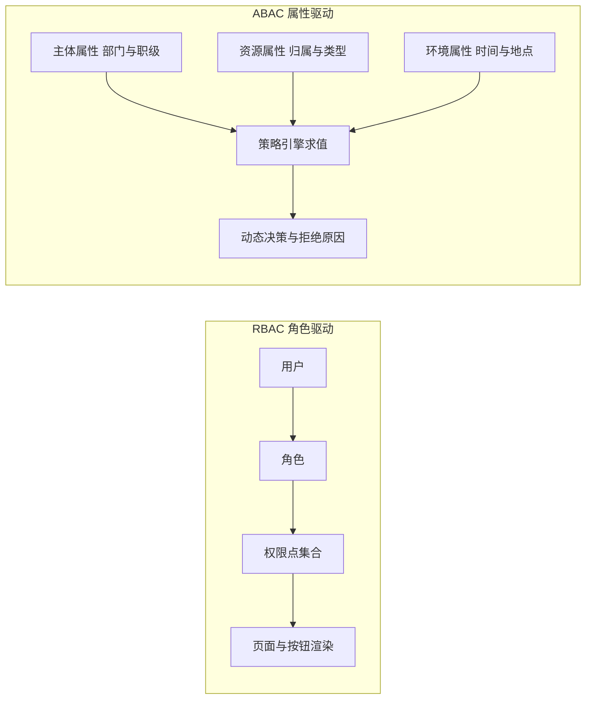

## PER-132：RBAC 与 ABAC 前端实现有什么区别？各自适用什么场景？

**答**：
- **RBAC**：用户→角色→权限点静态映射，实现简单、可解释性强，适合组织结构稳定的后台；缺点是角色爆炸（同一权限要在多个角色重复配置）。
- **ABAC**：按主体属性（部门/职级）、资源属性（归属/类型）、环境属性（时间/地点/设备）动态求值策略，表达力强，适合多维条件控制；缺点是难审计、调试成本高。
- 前端职责差异：RBAC 可以在构建期把权限点编译进路由表；ABAC 必须运行时求值，且要给策略引擎留"拒绝原因"用于展示。
- 工程惯例：大多数系统 RBAC 为主 + 少量 ABAC 规则兜底，两层结果取交集。



```javascript
// RBAC：角色到权限点静态映射，适合组织稳定的后台
const RBAC = {
  editor:  ['article:read', 'article:write'],
  auditor: ['article:read', 'article:audit'],
};
const canRBAC = (role, perm) => RBAC[role]?.includes(perm) ?? false;

// ABAC：主体/资源/环境属性动态求值，适合多维条件控制
const POLICIES = [
  (s, r, e) => s.dept === r.ownerDept && e.hour >= 9 && e.hour < 18,
];
const canABAC = (subject, resource, env = {}) => POLICIES.some((p) => p(subject, resource, env));

// 组合：RBAC 决定"有没有这个权限点"，ABAC 决定"此刻能不能用"
export function can(user, perm, resource, env) {
  if (!user.roles.some((r) => canRBAC(r, perm))) return { allow: false, reason: '无权限点' };
  if (POLICIES.length && !canABAC(user, resource, env)) return { allow: false, reason: '不在允许条件内' };
  return { allow: true };
}

console.log(canRBAC('editor', 'article:write')); // true
console.log(canABAC({ dept: 'a' }, { ownerDept: 'a' }, { hour: 10 })); // true
```
