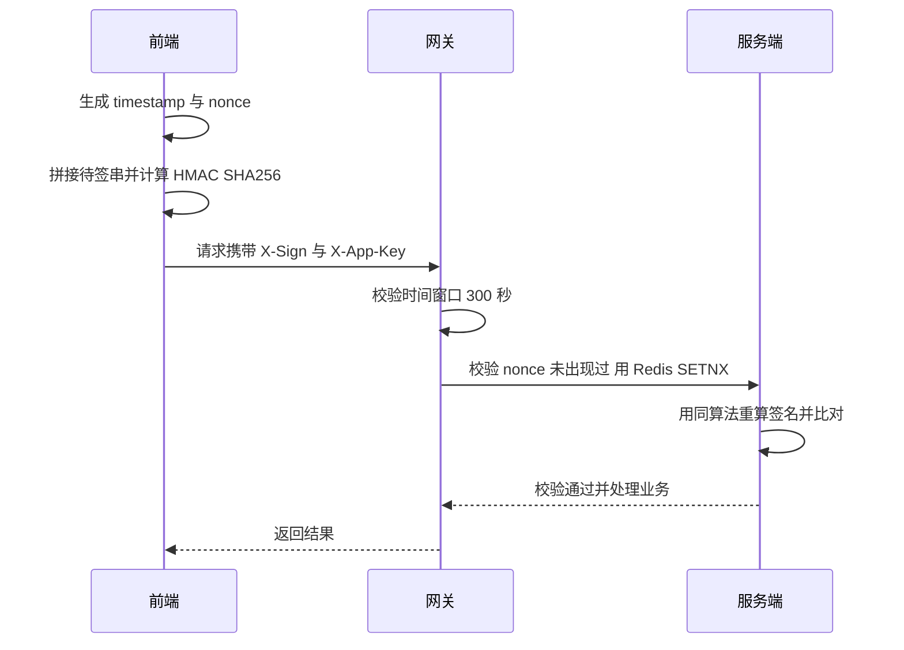

## PER-139：接口签名（时间戳 + nonce + HMAC）的完整实现？

**答**：
- 签名三要素：**时间戳**限制签名窗口（±300s，挡重放）、**nonce** 服务端短期去重（Redis SETNX，同一 nonce 只能被消费一次）、**HMAC** 保证参数不可篡改。
- 拼串规则前后端必须严格一致：方法、路径、时间戳、nonce、**按 key 排序后的参数**，用 `\n` 连接后做 HMAC-SHA256。
- 密钥管理：密钥进前端包即视为公开，签名的真正价值是提高伪造成本，核心风控判定永远在服务端。
- 失败返回统一 401 + 错误码细分（时间窗过期/nonce 重复/签名不符），便于前端排查。



```javascript
// 接口签名：时间戳窗口 + nonce 防重放 + HMAC 防篡改
import hmacSha256 from './hmac'; // 任何标准实现均可

const APP_KEY = 'web-app';
const SECRET = window.__RUNTIME_SECRET__; // 接口下发，进包即视为公开，核心校验在服务端

export function signRequest(method, path, params = {}) {
  const timestamp = Date.now();
  const nonce = Array.from(crypto.getRandomValues(new Uint8Array(8)),
    (b) => b.toString(16).padStart(2, '0')).join('');
  const sorted = Object.keys(params).sort().map((k) => `${k}=${params[k]}`).join('&');
  const raw = [method.toUpperCase(), path, timestamp, nonce, sorted].join('\n'); // 拼串规则与后端一致
  return {
    timestamp, nonce,
    'X-Sign': hmacSha256(SECRET, raw),
    'X-App-Key': APP_KEY,
  };
}

export async function apiGet(path, params = {}) {
  const qs = new URLSearchParams(params);
  const res = await fetch(`${path}?${qs}`, { headers: signRequest('GET', path, params) });
  if (res.status === 401) throw new Error('签名校验失败或已过期');
  return res.json();
}
```
