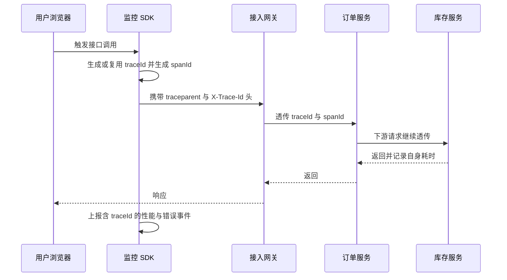

## PER-163：前端 traceId 如何透传到后端实现全链路追踪？

**答**：
- 标准做法：会话级 **traceId**（一次用户旅程复用）+ 请求级 **spanId**（每次请求新），按 W3C Trace Context 的 `traceparent` 头格式（`00-{traceId}-{spanId}-{flags}`）透传。
- 后端各服务把 traceId 写进访问日志与 APM，前端错误与性能事件也带同一 traceId——一屏看全"用户点击 → 网关 → 服务 → DB"。
- traceId 生成用 CSPRNG 32 hex；跨页面跳转用 sessionStorage 保持，SPA 内路由切换可选择性开新 trace。
- 兜底：自定义 `X-Trace-Id` 头兼容不支持 W3C 的老网关；上报采样时保留错误请求 100% 全量。



```javascript
// 前端 traceId 透传：W3C Trace Context + 自定义头兜底
export function getTraceId() {
  let t = sessionStorage.getItem('trace_id');
  if (!t) {
    t = Array.from(crypto.getRandomValues(new Uint8Array(16)),        // 32 hex，W3C trace-id 格式
      (b) => b.toString(16).padStart(2, '0')).join('');
    sessionStorage.setItem('trace_id', t);
  }
  return t;
}

export async function tracedFetch(input, init = {}) {
  const traceId = getTraceId();
  const spanId = Array.from(crypto.getRandomValues(new Uint8Array(8)),
    (b) => b.toString(16).padStart(2, '0')).join('');                 // 16 hex，请求级
  const headers = new Headers(init.headers);
  headers.set('traceparent', `00-${traceId}-${spanId}-01`);           // W3C 标准
  headers.set('X-Trace-Id', traceId);                                 // 老网关兜底
  const t0 = performance.now();
  const res = await fetch(input, { ...init, headers });
  report('span', {                                                    // 前端 span 与后端日志同 ID 可查
    traceId, spanId, url: String(input), status: res.status,
    dur: +(performance.now() - t0).toFixed(1),
  });
  return res;
}
```
