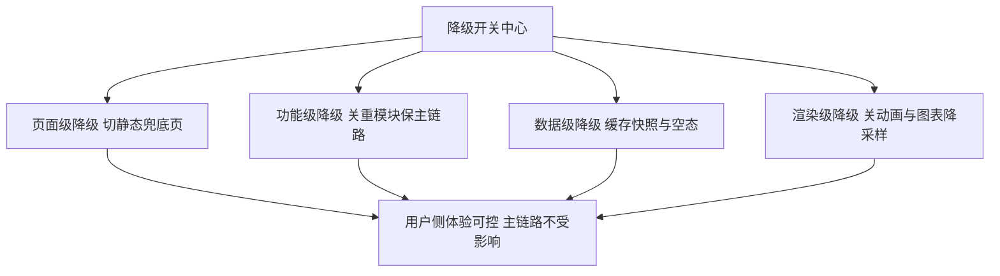

## PER-172：前端降级体系全景是怎样的（功能/数据/页面降级）？

**答**：
- 降级四类：**页面级**（整页切静态兜底页）、**功能级**（关重模块保主链路）、**数据级**（接口挂了读缓存快照/空态）、**渲染级**（关动画、图表降采样、长列表降密度）。
- 收敛到一个**降级开关中心**：所有降级点用统一 key 管理，运行时热生效；配置中心自身不可用时回退内置默认值——降级体系不能成为新的单点。
- 分级联动：大促/故障时按"预案编号"一键执行一组开关组合，而不是逐个翻开关。
- 降级要演练：每次大促前全量演练一遍降级开关，验证每个降级态用户可感知且可恢复。



```javascript
// 降级开关中心：所有降级点收敛到一个配置，运行时热生效
const FALLBACK_DEFAULTS = {
  'page:activity':     { mode: 'static', tpl: '/fallback/activity.html' },
  'feature:recommend': { mode: 'off' },
  'data:feed':         { mode: 'cache', ttl: 300000 },
  'render:chart':      { mode: 'sample', keepEvery: 4 },
};
let degradeState = { ...FALLBACK_DEFAULTS };

export async function loadDegradeConfig() {
  try {
    const remote = await fetchWithTimeout('/api/degrade/config', 1000).then((r) => r.json());
    degradeState = { ...FALLBACK_DEFAULTS, ...remote }; // 远端覆盖默认
  } catch {
    degradeState = { ...FALLBACK_DEFAULTS }; // 配置中心不可用回默认，降级体系自身不能成为单点
  }
}

export const isDegraded = (key) => degradeState[key]?.mode !== 'normal';

// 使用：功能降级
if (isDegraded('feature:recommend')) return renderSkeleton();
// 数据降级：读缓存快照
if (isDegraded('data:feed')) return cachedSnapshot('feed', degradeState['data:feed'].ttl);
```
