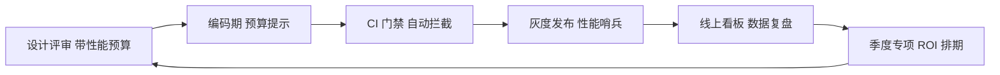

## PER-182：性能文化如何落地（评审/门禁/看板/复盘闭环）？

**答**：
- 闭环五环：**设计评审**带性能预算 → **编码期**预算提示 → **CI 门禁**自动拦截 → **灰度发布**性能哨兵 → **线上看板**数据复盘 → 季度专项把复盘结论转成 ROI 排期，回到评审。
- 文化抓手：指标进验收标准（不达标不算完成）、预算意识进 CR 话术（"这个依赖值不值 30KB"）、劣化事故必出 Action。
- 平台减负是关键：卡口自动拦、看板自动出，让业务开发"顺带做对"，而不是多一道手工负担——负担文化活不过三个月。
- 度量文化本身：门禁拦截率、按时修复率、专项完成率，证明文化在转而不是空转。



```yaml
# 性能文化闭环的卡口配置：评审/门禁/看板/复盘四环落地
perf_culture_gate:
  review:
    checklist: 性能预算进设计评审模板，新页面必须报预算
  ci_gate:
    bundle_budget:
      js_gzip_kb: 180
      css_gzip_kb: 40
    lighthouse_min_score: 85
    action: 超预算阻断合并，豁免需审批且 48 小时自动回收
  dashboards:
    - CWV 达标页占比（周更）
    - 门禁拦截与修复率（双周更）
    - 业务线性能排行（月更）
  retro:
    trigger: 劣化事故与超预算豁免
    output: 带 owner 与 deadline 的 Action 清单
  measure_culture:                # 度量文化自身
    - 门禁拦截率
    - 卡口后 2 周修复率
    - 季度专项完成率
```
