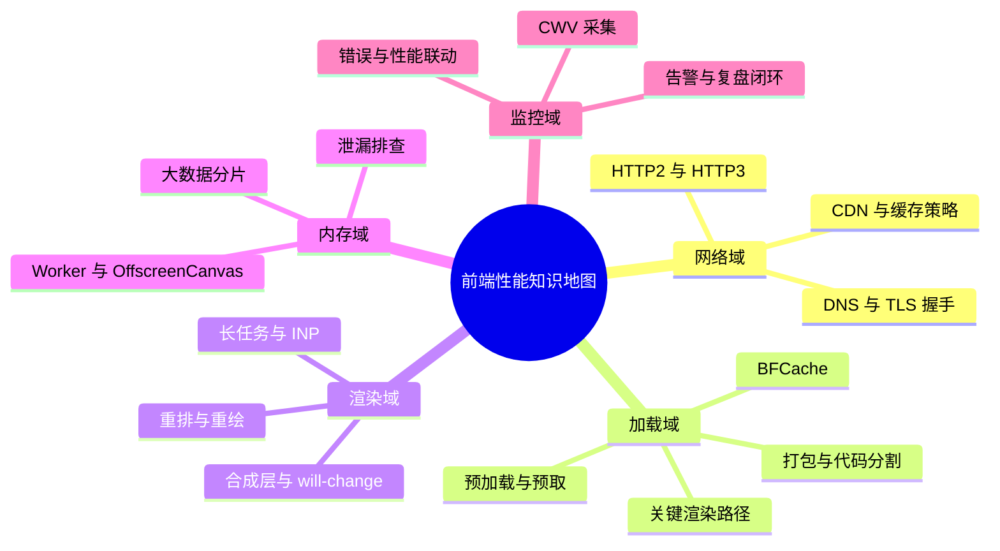

## PER-187：前端性能知识地图如何收束（网络/加载/渲染/内存/监控五域）？

**答**：
- 五域划分覆盖性能问题全集：**网络域**（握手/协议/CDN/缓存）、**加载域**（关键路径/预加载/打包分割/BFCache）、**渲染域**（重排重绘/合成层/长任务）、**内存域**（泄漏/分片/Worker）、**监控域**（采集/告警/复盘）。
- 答题范式：先定位"属于哪个域"→ 给指标（LCP/INP/CLS/内存曲线）→ 给方案 → 给防劣化，四段展示体系感。
- 域间传导关系常被追问：网络慢导致 LCP 差、渲染长任务伤 INP、内存泄漏拖垮一切——能画出传导链才说明真懂。
- 用这张图做自检：每道性能题都应能归位到某个域的某个节点。



```json
{
  "frontend_perf_knowledge_map": {
    "network_domain": ["DNS TLS 与 HTTP2 3", "CDN 与缓存层级", "弱网与重试策略"],
    "loading_domain": ["关键渲染路径", "预加载与预取", "打包与代码分割", "BFCache"],
    "render_domain": ["重排重绘与合成", "长任务与 INP", "虚拟滚动与时间切片"],
    "memory_domain": ["泄漏模式与排查", "分片与流式处理", "Worker 与 OffscreenCanvas"],
    "monitor_domain": ["CWV 与自定义指标", "错误与性能联动", "告警与复盘闭环"],
    "exam_tip": "五域答题顺序：先定位域，再给指标，再给方案，最后给防劣化"
  }
}
```
