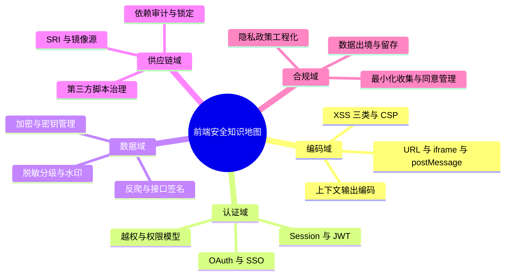

## PER-188：前端安全知识地图如何收束（编码/认证/数据/供应链/合规五域）？

**答**：
- 五域划分：**编码域**（XSS/CSP/输出编码/URL 与 iframe）、**认证域**（Session/JWT/OAuth/越权）、**数据域**（脱敏/水印/反爬/加密）、**供应链域**（依赖审计/SRI/第三方脚本）、**合规域**（最小化/同意管理/出境）。
- 答题范式：**威胁模型 → 检测手段 → 防御分层 → 兜底预案**四段，展示"不是背条文而是有方法论"。
- 五域交汇点：第三方脚本既是供应链风险也是性能税（与性能地图的加载域交汇）；认证凭证既是安全也是合规问题。
- 与 PER-187 的性能地图对称记忆：性能五域答"怎么快"，安全五域答"怎么不被打"，合起来就是本文件全景。



```json
{
  "frontend_security_knowledge_map": {
    "coding_domain": ["XSS 三类与 CSP", "上下文编码与富文本", "URL iframe 与 postMessage"],
    "auth_domain": ["Session JWT 与 OAuth", "越权与权限模型", "SSO 回调与凭证管理"],
    "data_domain": ["脱敏分级与水印", "反爬与接口签名", "加密与密钥管理"],
    "supply_chain_domain": ["依赖审计与版本锁定", "SRI 与镜像源", "第三方脚本治理"],
    "compliance_domain": ["最小化收集与同意管理", "数据出境与留存", "隐私政策工程化"],
    "exam_tip": "五域答题顺序：威胁模型 -> 检测手段 -> 防御分层 -> 兜底预案"
  }
}
```
