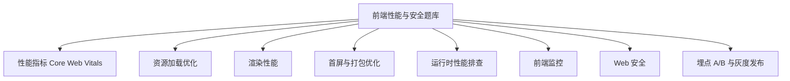

# 前端面试工程题库：性能优化与安全监控

本章节聚焦前端工程中最高频的两条主线：**性能**与**安全**。性能线覆盖 Core Web Vitals 指标体系、Performance API 采集、资源加载与渲染优化、首屏方案、打包产物优化、运行时排查与前端监控全链路；安全线覆盖 XSS/CSP、CSRF、点击劫持、中间人攻击、依赖供应链与敏感信息管理，并延伸到埋点、A/B 实验与灰度发布等工程实践。所有题目均来自真实工程场景，配合可运行的代码片段。

## 目录

- 一、性能指标与 Core Web Vitals（PER-001 ~ PER-008）
- 二、资源加载优化（PER-009 ~ PER-016）
- 三、渲染性能（PER-017 ~ PER-023）
- 四、首屏优化与打包产物优化（PER-024 ~ PER-028）
- 五、运行时性能排查（PER-029 ~ PER-032）
- 六、前端监控（PER-033 ~ PER-039）
- 七、Web 安全（PER-040 ~ PER-047）
- 八、埋点与 A/B、灰度发布（PER-048 ~ PER-050）
- 九、性能指标深水区（PER-051 ~ PER-057）
- 十、XSS 深水区（PER-058 ~ PER-064）
- 十一、认证与会话安全（PER-065 ~ PER-071）
- 十二、接口与数据安全（PER-072 ~ PER-078）
- 十三、供应链与运行时安全（PER-079 ~ PER-084）
- 十四、加载策略深水区（PER-085 ~ PER-091）
- 十五、运行时性能深水区（PER-092 ~ PER-098）
- 十六、监控体系深化（PER-099 ~ PER-105）
- 十七、安全与性能平台化（PER-106 ~ PER-111）
- 十八、综合案例与收束（PER-112 ~ PER-125）
- 十九、前端安全编码规范（PER-126 ~ PER-131）
- 二十、认证授权深水区（PER-132 ~ PER-137）
- 二十一、反爬与数据保护（PER-138 ~ PER-143）
- 二十二、隐私与合规（PER-144 ~ PER-149）
- 二十三、性能指标与业务结合（PER-150 ~ PER-155）
- 二十四、复杂场景性能（PER-156 ~ PER-162）
- 二十五、监控与可观测进阶（PER-163 ~ PER-169）
- 二十六、应急与预案（PER-170 ~ PER-175）
- 二十七、专项测试（PER-176 ~ PER-181）
- 二十八、体系收束（PER-182 ~ PER-200）

## 一、性能指标与 Core Web Vitals

