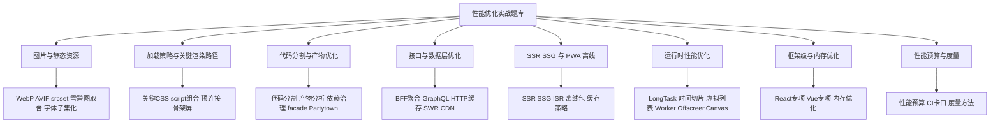

# 前端面试题库：性能优化实战

本章节聚焦性能优化的**落地手段**，与 09 章（指标定义、监控上报、安全）互补而不重复：09 章回答"怎么量"，本章回答"怎么改"。覆盖图片与静态资源接入实战、关键渲染路径与加载策略、代码分割与产物治理、接口与数据层优化（BFF/GraphQL/SWR）、SSR/SSG/ISR 与 PWA 离线、运行时性能（Long Task、时间切片、虚拟列表、Worker/OffscreenCanvas）、Vue/React 框架级性能专项、内存优化，最后落到性能预算与 CI 卡口的度量闭环。每题配一段与题目一一对应的可运行代码。

## 目录

- 一、图片与静态资源优化实战（OPT-001 ~ OPT-006）
- 二、加载策略与关键渲染路径（OPT-007 ~ OPT-012）
- 三、代码分割与产物优化（OPT-013 ~ OPT-019）
- 四、接口与数据层优化（OPT-020 ~ OPT-026）
- 五、SSR、SSG 与 PWA 离线（OPT-027 ~ OPT-030）
- 六、运行时性能优化（OPT-031 ~ OPT-036）
- 七、框架级与内存优化（OPT-037 ~ OPT-039）
- 八、性能预算与度量（OPT-040）
- 九、测量与分析体系（OPT-041 ~ OPT-047）
- 十、网络传输优化（OPT-048 ~ OPT-055）
- 十一、JS 执行优化（OPT-056 ~ OPT-064）
- 十二、渲染管线优化（OPT-065 ~ OPT-073）
- 十三、内存优化进阶（OPT-074 ~ OPT-080）
- 十四、框架专项：React（OPT-081 ~ OPT-088）
- 十五、框架专项：Vue（OPT-089 ~ OPT-095）
- 十六、Web Worker 与并行（OPT-096 ~ OPT-102）
- 十七、媒体与视觉优化（OPT-103 ~ OPT-109）
- 十八、端与平台特定（OPT-110 ~ OPT-120）
- 十九、首屏专项深水区（OPT-121 ~ OPT-128）
- 二十、交互与流畅度（OPT-129 ~ OPT-135）
- 二十一、状态与数据性能（OPT-136 ~ OPT-142）
- 二十二、构建侧性能（OPT-143 ~ OPT-149）
- 二十三、弱网与不稳定网络（OPT-150 ~ OPT-156）
- 二十四、内存与稳定性（OPT-157 ~ OPT-162）
- 二十五、性能监控与归因进阶（OPT-163 ~ OPT-169）
- 二十六、专项场景优化（OPT-170 ~ OPT-176）
- 二十七、新特性与新平台（OPT-177 ~ OPT-183）
- 二十八、体系与推进（OPT-184 ~ OPT-200）

## 一、图片与静态资源优化实战

