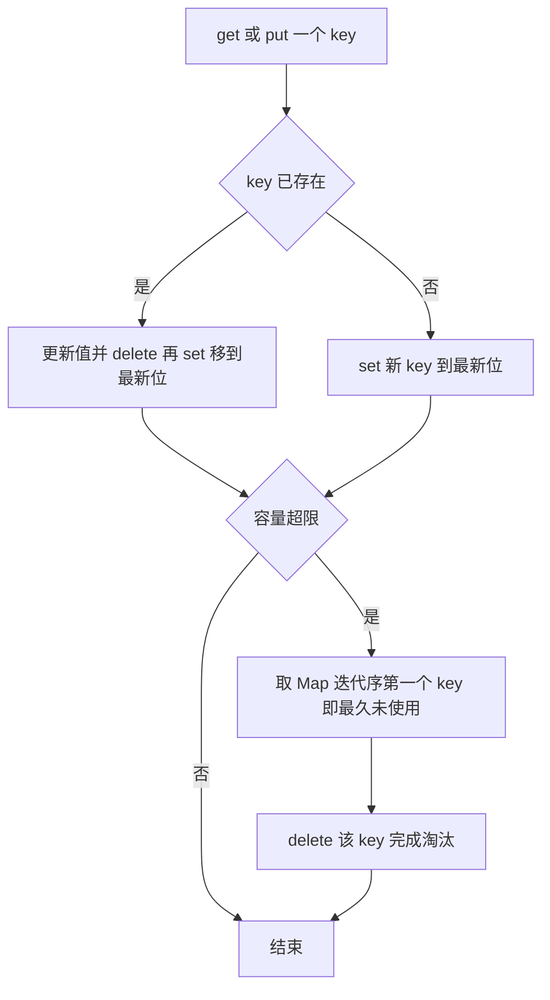

## ALG-048：Keep-Alive 组件缓存在内存中的实例数有上限，超出要淘汰"最久未访问"的组件实例。请用 Map 实现 LRU 缓存（get/put 均 O(1)）。
**答**：JS 的 `Map` 迭代顺序即插入顺序，可模拟双向链表：get/put 时先 `delete` 再 `set` 把 key 挪到"最新"位置；超容量时 `keys().next().value` 拿到最旧 key 删除。这比手写双向链表简洁得多（手写链表版见 ALG-047）。get/put 均 O(1)，空间 O(capacity)。

```javascript
class LRUCache {
  constructor(capacity) { this.cap = capacity; this.cache = new Map(); }
  get(key) {
    if (!this.cache.has(key)) return -1;
    const val = this.cache.get(key);
    this.cache.delete(key);
    this.cache.set(key, val);   // 重新插入 = 移到最新位置
    return val;
  }
  put(key, value) {
    if (this.cache.has(key)) this.cache.delete(key);
    this.cache.set(key, value);
    if (this.cache.size > this.cap) {
      const oldest = this.cache.keys().next().value; // 插入序最早者
      this.cache.delete(oldest);
    }
  }
}
```


