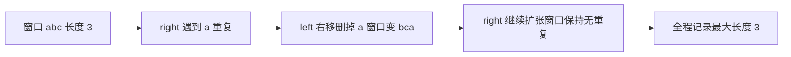

## ALG-058：输入联想的防抖之外，还要统计"输入框内容在本次会话中出现的最长无重复连续片段"（用于分析用户输入习惯）。如何用滑动窗口求无重复字符的最长子串？
**答**：右指针扩张，遇到重复字符时左指针收缩直到窗口内无重复（用 Set 记录窗口内字符），每步更新最大长度。右指针最多走 n 步、左指针最多走 n 步，整体线性——比暴力枚举所有子串的 O(n²) 高效得多。时间 O(n)，空间 O(字符集大小)。

```javascript
function lengthOfLongestSubstring(s) {
  const window = new Set();
  let left = 0, max = 0;
  for (let right = 0; right < s.length; right++) {
    while (window.has(s[right])) {
      window.delete(s[left++]); // 收缩左端直到去掉重复
    }
    window.add(s[right]);
    max = Math.max(max, right - left + 1);
  }
  return max;
}
// lengthOfLongestSubstring('abcabcbb') => 3
```


