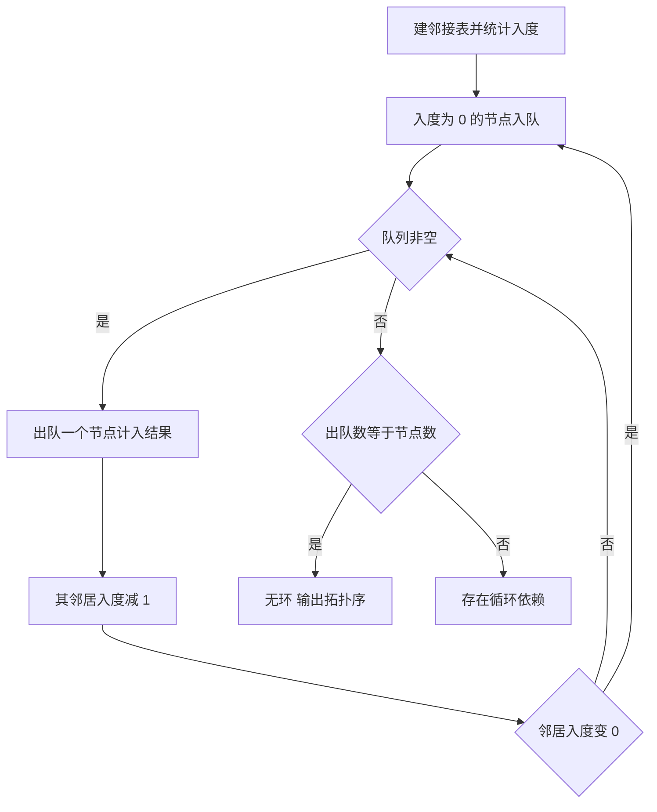

## ALG-087：前端构建编排里任务间有依赖（a 完成后才能跑 b），配置错误可能出现循环依赖导致死等。如何用拓扑排序（Kahn 算法）检测循环依赖并给出执行顺序？
**答**：统计每个节点入度，入度为 0 的进队列；依次出队、把邻居入度减 1，减到 0 就入队。最终出队数 < 节点数说明有环（环上的节点入度永远减不到 0）。这是大厂高频题，微前端加载、npm 依赖树、任务编排都靠它。时间 O(V + E)，空间 O(V + E)。

```javascript
function canFinish(n, deps) { // deps: [pre, next] 表示先 pre 后 next
  const graph = Array.from({ length: n }, () => []);
  const indegree = new Array(n).fill(0);
  for (const [pre, next] of deps) {
    graph[pre].push(next);
    indegree[next]++;
  }
  const queue = [];
  indegree.forEach((d, i) => d === 0 && queue.push(i));
  let done = 0;
  while (queue.length) {
    const cur = queue.shift();
    done++;
    for (const next of graph[cur]) {
      if (--indegree[next] === 0) queue.push(next);
    }
  }
  return done === n; // false 即存在循环依赖
}
```


