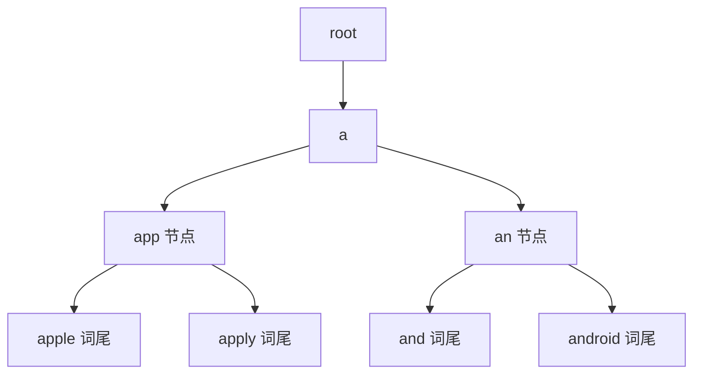

## ALG-090：搜索联想的核心数据结构是前缀树 Trie：输入 "ap" 立刻拿到 apple、apply 等所有候选。为什么 Trie 比"每次线性过滤词表"快？请实现 insert / search / startsWith？
**答**：Trie 把公共前缀共享：查询只走与输入长度相等的层数，O(L) 与词典规模无关；线性过滤是 O(词典大小 × L)。工程上每个 Trie 节点还可挂"该前缀下的 Top 热词"实现秒出联想。insert/search/startsWith 均 O(L)，空间 O(总字符数 × 字符集)。

```javascript
class Trie {
  constructor() { this.root = {}; this.END = '#'; }
  insert(word) {
    let node = this.root;
    for (const ch of word) {
      if (!node[ch]) node[ch] = {};
      node = node[ch];
    }
    node[this.END] = true; // 单词结束标记
  }
  _find(prefix) {
    let node = this.root;
    for (const ch of prefix) {
      if (!node[ch]) return null;
      node = node[ch];
    }
    return node;
  }
  search(word) {
    const node = this._find(word);
    return !!node && !!node[this.END]; // 必须有结束标记才算完整单词
  }
  startsWith(prefix) {
    return !!this._find(prefix);
  }
}
```


