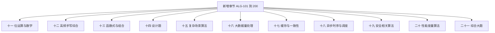

## ALG-100：综合大题：实现大文件（数 GB）上传全链路——分片、并发上限、失败重试、秒传（hash 命中直接跳过）、断点续传（跳过已传分片）。请给出核心调度代码？
**答**：完整链路五步：① `file.slice` 切成固定大小分片；② 抽样 hash（首尾 + 中间各取 2MB + 文件大小）用 `crypto.subtle` 算 SHA-256，先问服务端是否秒传；③ 服务端返回已传分片列表实现断点续传；④ 并发池（固定 active 数）上传分片，单片失败延迟后重新入队实现重试；⑤ 全部完成后通知服务端合并。核心是"队列 + 并发计数 + 补位调度"。时间 O(分片数)，空间 O(并发数)。

```javascript
async function uploadBigFile(file, { chunkSize = 5 * 1024 * 1024, concurrency = 3 } = {}) {
  const total = Math.ceil(file.size / chunkSize);
  // 1. 抽样 hash（首/中/尾各 2MB + 大小），秒传判断
  const sample = new Blob([
    file.slice(0, 2 * 1024 * 1024),
    file.slice(file.size / 2, file.size / 2 + 2 * 1024 * 1024),
    file.slice(-2 * 1024 * 1024),
  ]);
  const digest = await crypto.subtle.digest('SHA-256', await sample.arrayBuffer());
  const hash = [...new Uint8Array(digest)].map(b => b.toString(16).padStart(2, '0')).join('');
  // 2. checkExists / listChunks / uploadChunk / mergeChunks 为服务端接口
  const uploaded = new Set((await checkExists(hash)) ? await listChunks(hash) : []);
  const queue = Array.from({ length: total }, (_, i) => i).filter(i => !uploaded.has(i));
  let active = 0;
  return new Promise((resolve, reject) => {
    const next = () => {
      if (!queue.length && active === 0) return resolve(mergeChunks(hash, total));
      while (active < concurrency && queue.length) {
        const i = queue.shift();
        active++;
        uploadChunk(hash, i, file.slice(i * chunkSize, (i + 1) * chunkSize))
          .catch(() => new Promise(r => setTimeout(r, 1000))
            .then(() => queue.push(i))) // 失败重试：延迟后重新入队
          .finally(() => { active--; next(); });
      }
    };
    next();
  });
}
```

---

> 以上为第一至十章（ALG-001 ~ ALG-100）：数组、字符串、树、栈队列、链表、哈希、双指针、二分排序、动态规划与图。以下进入第十一至二十一章（ALG-101 ~ ALG-200）：位运算与数学、高频手写、函数式组合、设计题、复杂场景、大数据量、缓存一致性、异步调度、安全、性能度量与综合大题。

## 十一、位运算与数学

> ALG-101 ~ ALG-108：位运算技巧与数学基础在前端工程中的落地——虚拟列表容量取整、海量去重打点、埋点对账、权限位统计、指数退避容量、栅格等分、随机公平性、金额大数运算。


