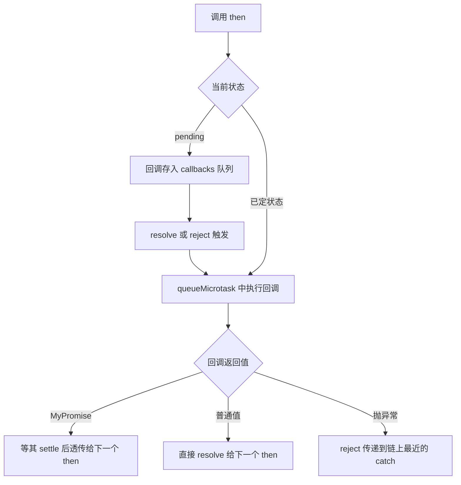

## ALG-109：核心手写题：实现一个支持状态机、then 链式调用、回调异步执行、值穿透的 Promise（简化版）？
**答**：三个要点：① 状态机 `pending -> fulfilled / rejected` 且不可逆，pending 期回调先存队列，settle 后依次执行；② then 必须返回新 Promise 才能链式调用，回调返回 Promise 时等其 settle 再透传，返回普通值直接 resolve，抛异常则 reject 到链上最近的 catch；③ 回调放进微任务（`queueMicrotask`）保证异步时序。时间 O(1) 每次 then，空间 O(回调数)。



```javascript
class MyPromise {
  constructor(executor) {
    this.state = 'pending'; this.value = undefined; this.reason = undefined;
    this.callbacks = [];
    const resolve = v => {
      if (this.state !== 'pending') return;
      if (v && typeof v.then === 'function') return v.then(resolve, reject); // 展开 thenable
      this.state = 'fulfilled'; this.value = v;
      this.callbacks.forEach(cb => cb());
    };
    const reject = r => {
      if (this.state !== 'pending') return;
      this.state = 'rejected'; this.reason = r;
      this.callbacks.forEach(cb => cb());
    };
    try { executor(resolve, reject); } catch (e) { reject(e); }
  }
  then(onFulfilled, onRejected) {
    return new MyPromise((resolve, reject) => {
      const handle = () => queueMicrotask(() => { // 微任务保证时序
        try {
          const r = this.state === 'fulfilled'
            ? (onFulfilled ? onFulfilled(this.value) : this.value)  // 未传则值穿透
            : (onRejected ? onRejected(this.reason) : (() => { throw this.reason; })());
          r instanceof MyPromise ? r.then(resolve, reject) : resolve(r);
        } catch (e) { reject(e); } // 抛异常沿链传递
      });
      this.state === 'pending' ? this.callbacks.push(handle) : handle();
    });
  }
  catch(onRejected) { return this.then(null, onRejected); }
}
```
