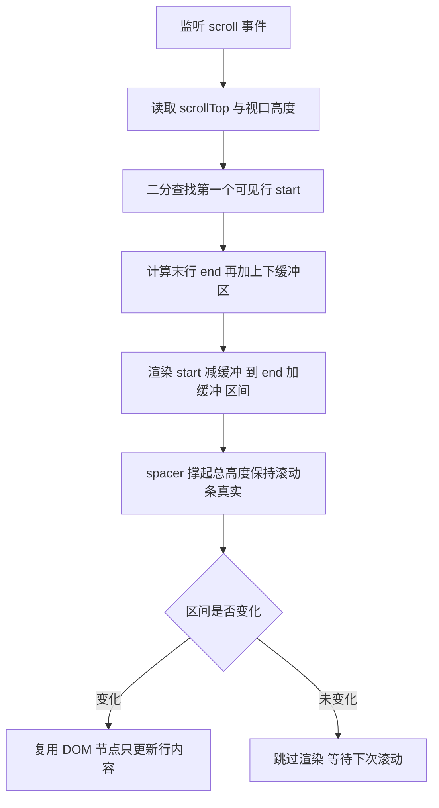

## ALG-130：设计一个定高虚拟列表：1 万行日志，DOM 只渲染视口 + 缓冲区，滚动流畅 60fps。给出渲染区间计算与占位方案？
**答**：三个核心件：① 总高度占位——外层容器高度 = total × rowHeight，滚动条长度真实；② 区间计算——start = 满足「首个未滚出视口顶部」的行号，定高可直接 `Math.floor(scrollTop / h)`，用二分实现是为兼容"前缀和存变高行"的扩展（复杂度 O(log n)）；③ 缓冲区——上下各多渲染 N 行，慢速滚动时避免白屏。DOM 复用：只更新可见节点的 data，不重建。整体滚动响应 O(log n)。



```javascript
class FixedVirtualList {
  constructor(scrollEl, itemHeight, { buffer = 5 } = {}) {
    this.el = scrollEl; this.h = itemHeight; this.buffer = buffer;
    this.total = 0; this.lastRange = [-1, -1];
    scrollEl.addEventListener('scroll', () => this.render());
  }
  setTotal(n) { this.total = n; this.el.style.height = n * this.h + 'px'; this.render(); }
  render() {
    const scrollTop = this.el.scrollTop, viewport = this.el.clientHeight;
    let lo = 0, hi = this.total - 1, start = 0;   // 二分找第一个可见行
    while (lo <= hi) {
      const mid = (lo + hi) >> 1;
      if (mid * this.h < scrollTop) { start = mid; lo = mid + 1; }
      else hi = mid - 1;
    }
    const end = Math.min(this.total, Math.ceil((scrollTop + viewport) / this.h) + this.buffer);
    const s = Math.max(0, start - this.buffer);   // 上缓冲
    if (s === this.lastRange[0] && end === this.lastRange[1]) return; // 区间未变不重渲染
    this.lastRange = [s, end];
    this.paint(s, end, s * this.h);               // 偏移定位 + 复用节点
  }
}
```
